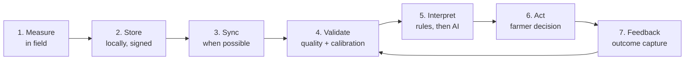
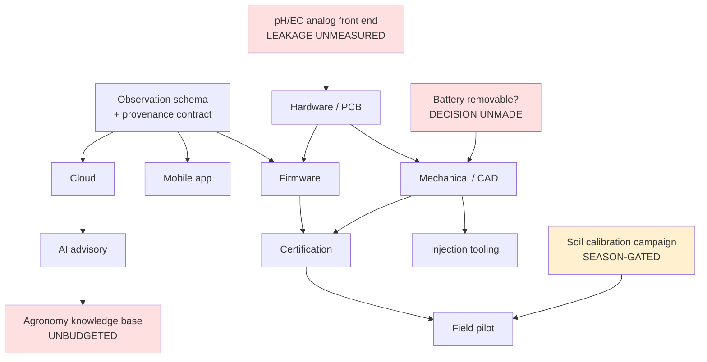
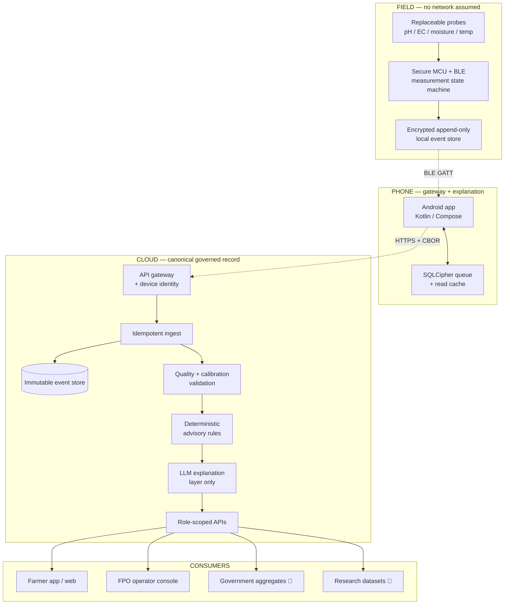
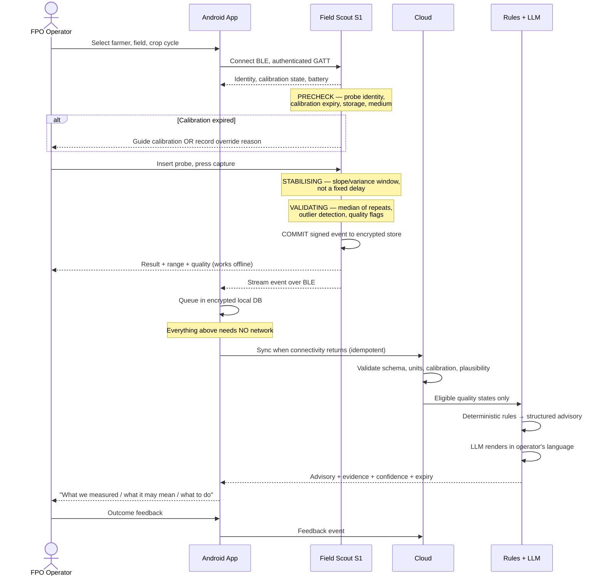
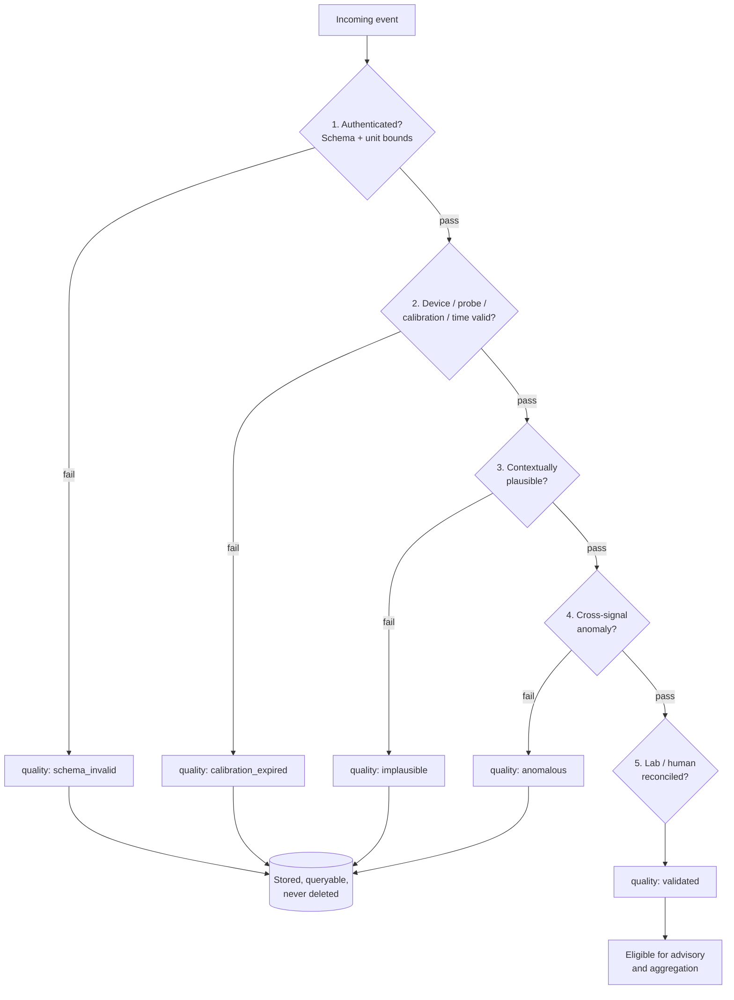
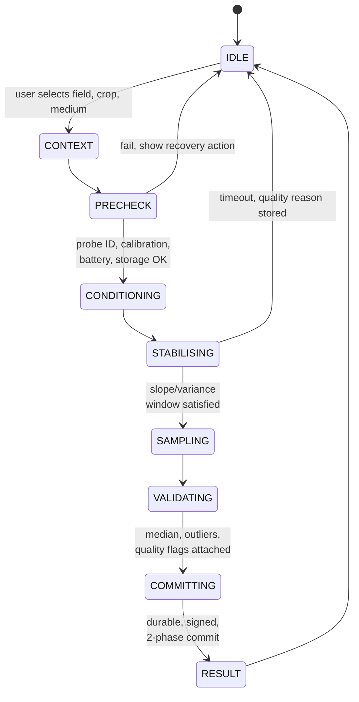
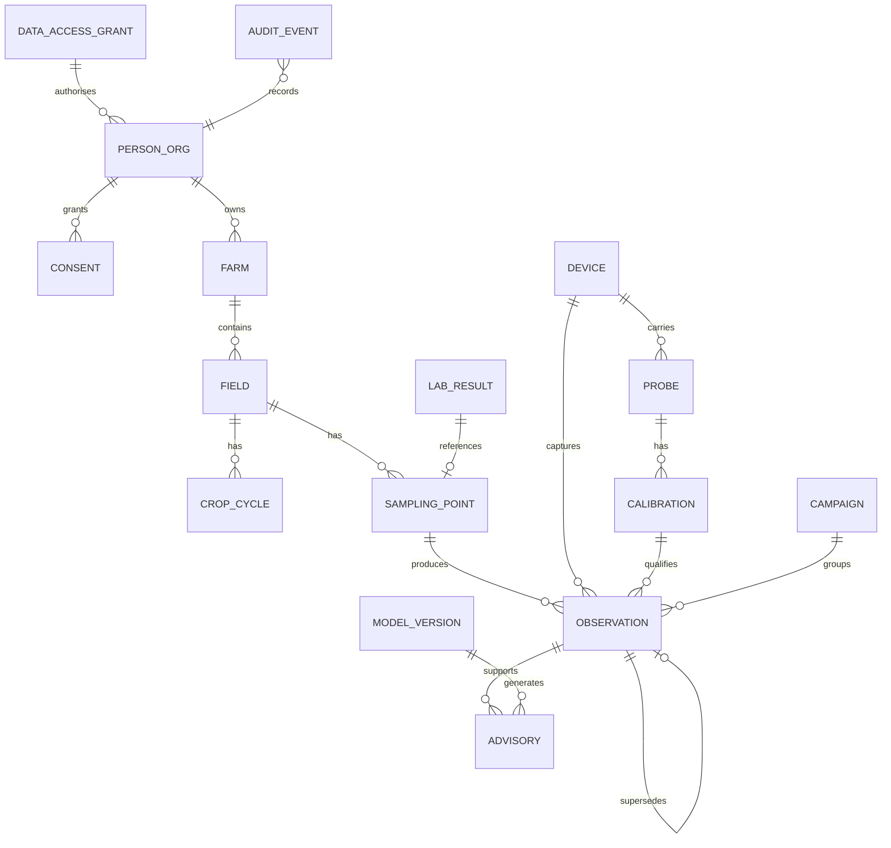
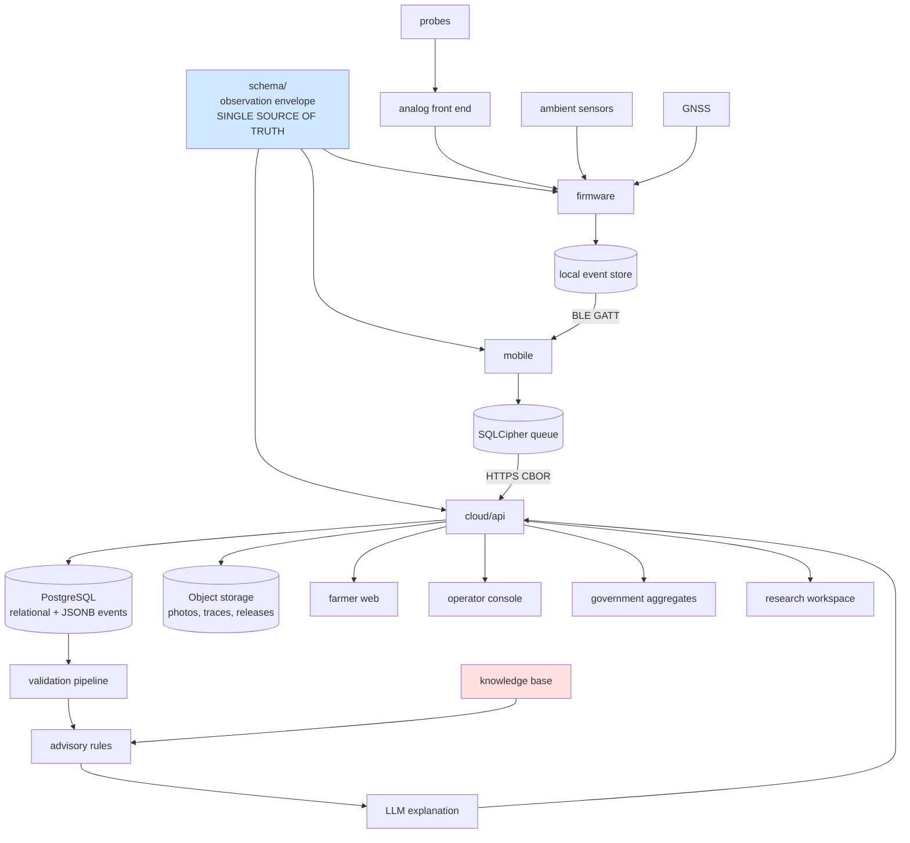
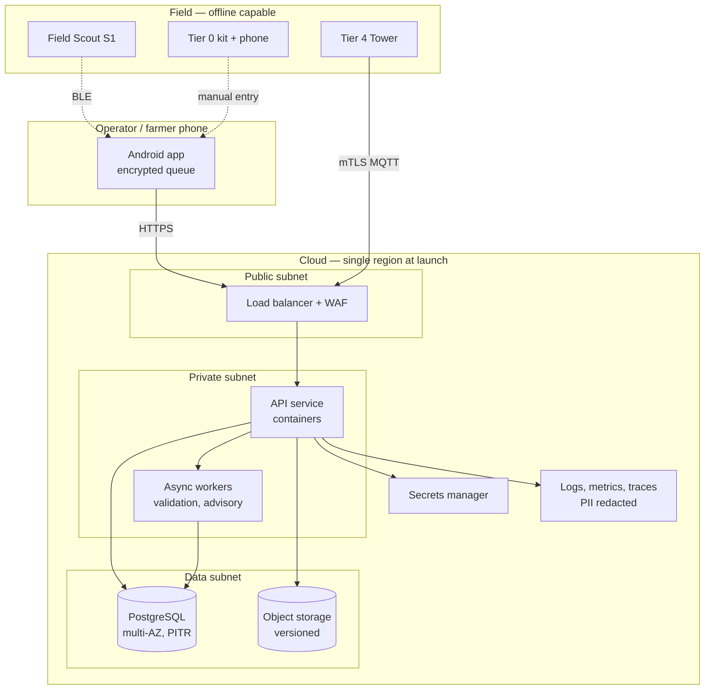
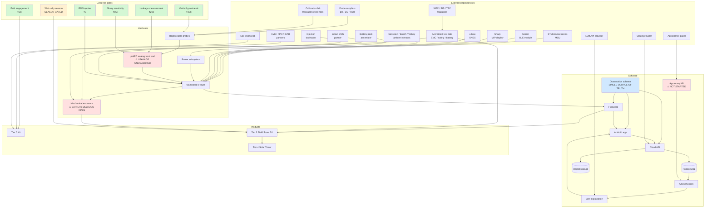

# AgriGrow — Master Overview

> **Read this document first. It is the navigation hub for the entire project.**
>
> **Document ID:** AGR-MASTER-000 · **Version:** 1.0 · **Date:** 2026-07-31
> **Supersedes:** nothing. **Superseded by:** nothing.
> **Scope:** Explains the whole system, links every other document, and states honestly what exists and what does not.

---

## ⚠️ READ THIS BOX BEFORE ANYTHING ELSE

**AgriGrow is currently a specification package. No part of it has been built.**

| What exists | What does not exist |
|---|---|
| 28 engineering specification documents (00–27), ~187 KB | Any source code |
| A complete architecture, tier model and data contract on paper | Any schematic, PCB layout, or Gerber file |
| Component candidate register with costed planning bands | Any mechanical CAD or enclosure |
| Validation plans, compliance matrices, manufacturing gates | Any prototype, breadboard or bench measurement |
| A benchmark survey of 18 competing products | Any customer, purchase order, or letter of intent |
| A business model and cost-engineering plan | Any funding, team, or hired engineer |
| Two independent buildability reviews (see [Buildability Summary](#buildability-summary)) | Any certification, quote, or supplier agreement |

**Assumed resource context:** solo founder / student, self-funded, ₹20,000–₹2,00,000 accessible for the next stage. All cost and time estimates in this document assume that, not a funded team.

**If you are an investor, professor, or recruiter:** the correct question is not "is the architecture good?" (it is) but "what evidence exists?" (none yet). Jump to [Buildability Summary](#buildability-summary) and [Development Roadmap](#development-roadmap).

**If you are a future contributor or future-me:** jump to [Quick Start Guide](#quick-start-guide).

---

## Table of contents

1. [Project Overview](#project-overview)
2. [Complete System Overview](#complete-system-overview)
3. [Architecture Overview](#architecture-overview)
4. [Component Map](#component-map)
5. [Folder Structure](#folder-structure)
6. [Document Index](#document-index)
7. [System Workflow](#system-workflow)
8. [Data Flow](#data-flow)
9. [Feature Map](#feature-map)
10. [Development Roadmap](#development-roadmap)
11. [Technology Stack](#technology-stack)
12. [Design Decisions](#design-decisions)
13. [Engineering Principles](#engineering-principles)
14. [Risk Summary](#risk-summary)
15. [Buildability Summary](#buildability-summary)
16. [Quick Start Guide](#quick-start-guide)
17. [Complete Dependency Graph](#complete-dependency-graph)
18. [Executive Summary](#executive-summary)
19. [Appendix A — Known Gaps and Inconsistencies](#appendix-a--known-gaps-and-inconsistencies)

---

# Project Overview

## Project name

**AgriGrow** — an agricultural field-measurement platform for India.
First reference product: **Field Scout S1** (Tier 2 handheld).

## Mission

Turn a time-stamped, geolocated, quality-scored soil or water observation into an explainable action — irrigate, sample again, consult an expert, apply an approved input, or wait — for users who currently have no trustworthy measurement at all.

## Vision

A trusted field-data layer for Indian agriculture that becomes more useful as protocols, calibration references, agronomy validation and service coverage mature — **not** as more sensors are added.

## Problem statement

Indian smallholders make soil and irrigation decisions with almost no measured data. The existing options each fail differently:

| Existing option | How it fails |
|---|---|
| Soil Health Card (government lab testing) | Comprehensive and near-free, but slow turnaround, no time series, sampling quality varies |
| Premium sensor platforms (CropX, Arable, Fasal) | Technically excellent, priced for medium/large and horticulture farms |
| Cheap consumer "soil testers" | Sell numbers with no method, no calibration, no uncertainty — actively misleading |
| Nothing | The default for most of the 68.45% of holdings under 1 ha |

The gap is not sensing technology. **The gap is a trustworthy, serviceable, affordable measurement service with honest provenance.**

## Target users

| Persona | Job to be done | Which tier serves them |
|---|---|---|
| **FPO / extension worker / agri-dealer** ⭐ | Measure many farms consistently, run campaigns | Tier 0, 2, 3 — **primary commercial target** |
| Soil testing lab | Faster geotagged sample intake and chain of custody | Tier 0, 3 |
| Smallholder farmer (marginal, <1 ha) | A trustworthy, affordable recommendation | Tier 0 (assisted); Tier 1/2 via shared or rental |
| Horticulture / progressive farmer | Irrigation and salinity decisions with real economics | Tier 3, 4 |
| Agronomist | Compare field history with crop context | Tier 3, 6 + dashboards |
| KVK / agricultural university | Training, technology assessment, validation partner | Tier 0, 3, 6 |
| Government programme owner | Anonymised authorised regional signals | Tier 7–9 (long term) |
| Researcher | Reproducible, permissioned datasets | Tier 6 + research platform |

> ⭐ **Positioning correction made during review.** The original specification targeted the Tier 2 handheld at individual small farmers. That has been reassessed: at ₹13,000–20,000 against a ₹12,698/month average rural household income (NAFIS 2021–22, cited in [26](agri_intelligence_platform/26_india_market_adoption_and_cost_engineering.md)), for a measurement most farmers need twice a year, the individual-farmer purchase does not close. **The buyer is an organisation with a trained operator.** See [Design Decisions](#design-decisions) → D-13.

## Core value proposition

Three things nobody else in this market does together:

1. **Honest provenance.** Every observation carries method, medium, depth, units, raw-vs-derived status, calibration state, uncertainty and quality flags — and the platform *refuses* to aggregate incomparable measurements. This is the project's only real moat.
2. **Assisted, serviceable entry.** A ₹900–2,000 manual kit and an operator-run instrument, with replaceable probes, scheduled calibration and a real repair path — instead of a sealed premium device or a misleading cheap one.
3. **Truth before prediction.** AI may estimate; it may never relabel an estimate as an instrument reading. High-risk, low-confidence cases escalate to a human.

## One-paragraph executive summary

AgriGrow is a tiered agricultural measurement platform for India — from a ₹900 manual soil-sampling kit through a serviceable handheld instrument and a solar field station, up to governed district and state aggregates. Its differentiator is not sensor accuracy, which it cannot win against research-grade instruments, but **provenance and serviceability**: every measurement records how it was taken, with what calibration, at what uncertainty, and the platform enforces those boundaries in every query, model and dashboard. The system spans hardware, firmware, an offline-first Android app, a governed cloud, and a deliberately bounded AI advisory layer. It exists today as 28 specification documents with a rigorous self-assessed buildability register that correctly excludes in-field N/P/K sensing, LLM-driven actuation and a national raw-data lake as not achievable with current technology. **Nothing has been built.** The immediate next step is not more architecture but four measurements and one purchase order, at a cost of roughly ₹20,000.

---

# Complete System Overview

## Explained to a new engineer in one page

AgriGrow has **one job**: get a soil or water measurement from a field into a form somebody can act on, without ever lying about how good that measurement is.

Everything in the architecture follows from that sentence. The tier model exists because a colour-comparator strip and a research TDR probe are both legitimate but **not interchangeable** — so the system must carry that distinction end to end. The offline-first design exists because rural connectivity cannot be assumed. The calibration gates exist because an uncalibrated electrochemical reading is worse than no reading. The AI boundary exists because a plausible wrong answer about fertiliser costs a farmer a season.

### High-level workflow



Steps 1–3 must work with **zero network**. Steps 4–5 are the only places a measurement may be annotated, never altered. Step 6 is always a human. Step 7 is what makes the platform improve over time.

### The tier model

Ten tiers, one data contract. A tier is a **capability and service designation**, not a claim that a lower-tier observation substitutes for a higher-tier one.

| Tier | Product | Buyer | Role in the system |
|---:|---|---|---|
| 0 | Soil Test Kit | KVK / FPO assisted | Manual screening + sample chain. `manual_test` method. |
| 1 | Pocket Basic | Marginal farmer (shared) | Lowest-cost labelled spot checks |
| 2 | **Field Scout S1** | FPO / operator | Reference product. Serviceable spot measurements + GNSS |
| 3 | FieldLab Backpack | FPO / extension | Professional campaign kit with reference controls |
| 4 | Solar Farm Tower | Medium farm / horticulture | Fixed continuous site time series |
| 5 | Multi-Tower Network | Commercial farm | Site network + **supervised** actuation |
| 6 | Research Station | University / lab | Traceable reference instruments |
| 7 | District Station | District programme | Reference nodes + fleet operations |
| 8 | State Grid | State department | Federation and governance plane |
| 9 | National Network | National | Standards and interoperability, **not** a central data lake |

**Launch set is Tiers 0, 2 and 4.** Everything else is roadmap. See [Development Roadmap](#development-roadmap).

### Major subsystems and responsibilities

| Subsystem | Owns | Must never |
|---|---|---|
| **Hardware / probes** | Physical sensing, protection, serviceability | Present an uncalibrated reading as validated |
| **Firmware** | Measurement state machine, local durable store, OTA, safety interlocks | Contain an agronomy model that can't be audited or updated |
| **Mobile app** | Identity, offline queue, device gateway, explanation | Require network to complete a measurement |
| **Cloud** | Canonical governed record, validation, policy | Silently "clean" a raw measurement |
| **AI layer** | Convert validated observations into bounded options | Invent a dosage, diagnosis, entitlement or sensor value |
| **Dashboards** | Role-scoped views | Use front-end hiding as access control |
| **IoT platform** | Device identity, commissioning, fleet ops | Store a production device private key |
| **Security / privacy** | Consent, purpose-based access, audit | Make basic measurement conditional on marketing or research consent |

### Dependency order (what blocks what)



**Three red boxes are the real blockers.** Two are single decisions or single measurements. See [Appendix A](#appendix-a--known-gaps-and-inconsistencies).

---

# Architecture Overview

Every layer, and why it exists. Layers marked 🔻 are **deliberately simplified from the original specification** — see [Buildability Summary](#buildability-summary).



## Layer-by-layer rationale

### Hardware layer

**Why it exists:** software cannot measure soil. Everything upstream depends on a physical reading whose uncertainty is known.

Baseline (frozen in [02](agri_intelligence_platform/02_hardware_device_srs.md) §7): Cortex-M33 secure MCU + discrete BLE module + 16 MB QSPI NOR + memory-in-pixel LCD + 4,000 mAh 1S Li-ion + USB-C 5 V + multi-constellation GNSS + vented ambient sensors + replaceable pH / four-electrode EC / moisture probes.

**Why not a Linux SBC:** boot time, power, cost, update attack surface and field reliability are all worse, and a handheld needs none of the benefits.
**Why a discrete BLE module rather than an integrated SoC:** reduces RF certification and antenna risk, and keeps the noisy radio away from a high-impedance analog node.
**Why replaceable probes:** a glass pH electrode is a 6–18 month consumable. A sealed device containing a consumable is a disposable device.

### IoT / device-identity layer

**Why it exists:** at fleet scale, "which device produced this, is it still authorised, and what was it calibrated with" is a security and data-integrity question, not a convenience.

Every electronic unit carries a unique cryptographic identity, SKU/revision, manufacturing test record, ownership state and revocation status. Tier 0 kits use batch/lot/expiry identity only and **must never impersonate a calibrated device.** Commissioning is a repeatable, signed procedure — a moved tower is *recommissioned*, not given a new map pin.

### Firmware layer

**Why it exists:** a measurement must be durable and honest before any network is involved.

The core is a state machine: `IDLE → CONTEXT → PRECHECK → CONDITIONING → STABILISING → SAMPLING → VALIDATING → COMMITTING → RESULT`. Every transition has a timeout and a human-readable recovery action. `STABILISING` uses a sensor-specific slope/variance window, not a fixed delay — a fixed delay is how you ship a wrong number confidently.

**Why an RTOS and not bare metal:** independent drivers, storage, connectivity and OTA need deterministic priorities, timeouts, memory boundaries and test seams.

### Mobile layer

**Why it exists:** it is the farmer's identity, offline record, device gateway and — most importantly — the **explanation** layer. The device produces a number; the app makes it mean something.

Android-first because that is the Indian device reality. Offline-first because connectivity is not a given. The handheld can complete a measurement with the phone absent.

### Backend / cloud layer 🔻

**Why it exists:** to be the canonical governed record — and to enforce, at query time, the comparability rules the tier model promises.

**Simplified from spec.** [05](agri_intelligence_platform/05_cloud_backend_srs.md) §3 specifies a relational store *plus* object storage *plus* an immutable columnar lake *plus* a time-series/OLAP store *plus* a versioned feature store, against a design target of 10 M devices and 100 M events/day. That is correct for the target and wrong for now. **Launch architecture: one PostgreSQL instance (JSONB events + `pg_partman`) and one object-storage bucket.** That configuration serves ~50,000 devices. Revisit at 20,000.

### Database layer

| Store | Holds | Why separate |
|---|---|---|
| PostgreSQL — relational tables | Identity, consent, farms, fields, devices, probes, calibration, orders | Transactional integrity, foreign keys, row-level security |
| PostgreSQL — `observations` (JSONB, partitioned) | Immutable event envelopes | Append-only; schema evolves without migration pain |
| Object storage | Photos, raw ADC traces, dataset releases, firmware images | Cheap, large, versioned |

**Non-negotiable:** raw observations are retained forever and never rewritten. Derived values are *reproducible* from immutable source events + calibration version + algorithm version. Corrections are new linked events, never mutations.

### AI / ML layer 🔻

**Why it exists:** a farmer cannot act on `pH 6.4, EC 0.8 mS/cm, VWC 22%`. Something must convert measurement into option.

**Simplified from spec.** The architecture in [06](agri_intelligence_platform/06_ai_agent_system_srs.md) is well-designed and stays as the target. For launch it reduces to:

```
validated observation → deterministic rules + thresholds → structured advisory
                                                              ↓
                                              LLM renders it in the user's language
```

The LLM **explains a conclusion the rules already reached.** It never generates the conclusion. Rules give ~80% of the value at ~10% of the cost and ~5% of the liability, and they are auditable when something goes wrong.

Confidence is a composite of sensor quality, calibration freshness, contextual coverage, model uncertainty and applicability. Below threshold, the system says what is *missing* and offers a measurement or a referral — it does not guess.

### Security layer

Defence in depth, per [12](agri_intelligence_platform/12_security_privacy_srs.md):

| Layer | Controls |
|---|---|
| Firmware | Secure boot, signed A/B OTA, locked debug, unique non-exportable key, encrypted local store |
| Mobile | OIDC, short-lived tokens, Android Keystore, certificate pinning, no secrets in client |
| Cloud | Least-privilege workload identity, secrets manager, tenant + purpose-aware authorisation, immutable audit |
| Data / AI | Minimisation, redacted logs, feature permissions, prompt and tool isolation, kill switch |

**Launch reduction:** signed OTA with rollback and unique device keys are in from day one. Full TrustZone partitioning, secure-element attestation and anti-rollback enforcement are V2 hardening.

### Authentication and authorisation

Phone/OTP or assisted identity for farmers; OIDC + MFA for privileged roles. **Purpose-based access, not "logged in."** Every query carries role, tenant, purpose code and time; the policy decision is logged. Government and research access is separately approved, time-limited, and aggregate/de-identified by default.

### Monitoring / observability

Track what predicts failure, not vanity metrics: activation-to-first-valid-measurement, calibration freshness distribution, sync latency and backlog depth, OTA success/rollback rate, crash rate, advisory override rate, repair turnaround, data-quality state distribution, privacy/security events.

### Deployment

Infrastructure-as-code, separate dev/staging/production, canary with automatic rollback, **no production personal data in lower environments**. DR tested at least twice yearly by actually restoring a clean environment and replaying events — not by reading a runbook.

### Communication

| Link | Used for | Why |
|---|---|---|
| **BLE 5.x GATT** | Device ↔ phone | Mandatory. Lowest cost, lowest power backhaul |
| HTTPS + CBOR | Phone → cloud ingest | Compact for 2G; schema-versioned |
| HTTPS + JSON | Management and query APIs | Ordinary tooling, OpenAPI contracts |
| mTLS + MQTT | Tower/gateway → cloud (Tier 4+) | Device-authenticated, store-and-forward |
| LoRaWAN | Private farm networks (Tier 5) | Only where a radio survey supports it |

**Rule:** transport may change; **event schema and quality semantics must not.**

---

# Component Map

**Status legend:** `SPEC` = specified only, nothing built · `DECISION OPEN` = spec contradicts itself or defers · `NOT STARTED` = not yet specified in detail
**TRL** = Technology Readiness Level *in AgriGrow's actual operating environment*, not in a laboratory.

| Component | Purpose | Technology | Depends on | Used by | Status | TRL | Priority |
|---|---|---|---|---|---|:--:|---|
| Observation schema + provenance contract | The single data contract across all tiers | CBOR / JSON Schema, UUIDv7 | — | Everything | **SPEC** | 8 | **P0 — build first** |
| Tier 0 Soil Test Kit | Manual screening + sample chain | Auger, comparator, QR, strips | Lot control | FPO, KVK, farmer | **SPEC** | 9 | **P0** |
| pH analog front end | High-impedance electrometer for glass electrode | LMP91200-class + guarded PCB | — | Tier 1–3 | **SPEC — leakage unmeasured** | **5** | **P0 — measure now** |
| EC measurement chain | 4-electrode AC conductivity | AC excitation + sync detection | — | Tier 1–3 | SPEC | 6 | P1 |
| Moisture probe + calibration | Volumetric water content | Coated FDR/capacitance | Gravimetric campaign | Tier 1–6 | **SPEC — no calibration data** | **5** | **P0** |
| Field Scout S1 mainboard | Tier 2 electronics | STM32U5 + nRF52840 module, 6-layer | AFE, power | Firmware, mechanical | SPEC | 4 | P1 |
| Mechanical / enclosure | IP54 housing, gasket, probe port | PC+ABS + TPE, injection moulded | **Battery decision** | Certification | **DECISION OPEN** | 3 | **P0 — decide** |
| Power subsystem | Charge, gauge, rails, protection | BQ24074, MAX17048, TPS63070 | Battery pack | Mainboard | SPEC | 6 | P1 |
| Firmware — measurement engine | State machine, stabilisation, quality flags | FreeRTOS or Zephyr, C | Mainboard | App, cloud | SPEC | 5 | P1 |
| Firmware — local event store | Encrypted append-only, 2-phase commit | Custom on QSPI NOR | Schema | Sync | SPEC | 6 | P1 |
| Firmware — OTA | Signed A/B with rollback | MCUboot-class | Device identity | Fleet ops | SPEC | 8 | P1 |
| Android app | Identity, offline queue, gateway, explanation | Kotlin, Compose, Room+SQLCipher, WorkManager | Schema, BLE | Farmer, operator | SPEC | 8 | **P0** |
| Voice + pictogram UI | Primary interface for low-literacy users | TTS + illustrated flows | App | Farmer | **SPEC — marked optional, should be required** | 6 | **P0** |
| Cloud ingest | Idempotent, durable-ack | PostgreSQL + object storage | Schema | Everything | SPEC | 9 | **P0** |
| Validation pipeline | Quality, calibration, plausibility staging | SQL + application rules | Ingest | AI, dashboards | SPEC | 8 | P1 |
| Advisory rules engine | Deterministic irrigation / pH / EC risk logic | Application code + config | Validation | App | SPEC | 7 | P1 |
| LLM explanation layer | Render an advisory in the user's language | LLM API, schema-validated output | Rules | App | SPEC | 8 | P2 |
| **Agronomy knowledge base** | Curated versioned crop/region guidance | Content + review workflow | Agronomists | Rules, LLM | **NOT STARTED — unbudgeted** | 6 | **P1** |
| Device registry / fleet ops | Identity, commissioning, campaigns | Cloud service | Provisioning | Ops | SPEC | 8 | P2 |
| Farmer web dashboard | Family / advisor assistance | Web | Cloud APIs | Farmer, delegate | SPEC | 9 | P3 |
| FPO operator console | Campaign and fleet management | Web | Cloud APIs | FPO | SPEC | 9 | P2 |
| Government dashboard | k-anonymous programme aggregates | Web + suppression logic | Validation | Programme owner | SPEC | 7 | P4 |
| Research platform | Permissioned reproducible datasets | Workspace + catalogue | Governance | Researcher | SPEC | 7 | P4 |
| Tier 4 Solar Tower | Fixed continuous station | 40 W solar, LiFePO₄, SDI-12, LTE/LoRa | Siting, install | Farm, district | SPEC | 8 | P3 |
| Tier 5 network + actuation | Supervised irrigation | Gateway + **independent safety controller** | Safety case, FTO | Commercial farm | SPEC | 6 | P5 |
| Marketplace | Input/service commerce | — | Licensing | — | **REMOVED** | — | **Cut** |
| Tier 8/9 federation | State/national interoperability | Federated APIs | Programme agreements | Government | SPEC | 4 | **Vision only** |

---

# Folder Structure

## What actually exists today

```
AgriGrow/
├── README.md                            ← THIS FILE (start here)
├── EXECUTION_PRINCIPLES.md              ← operating doctrine: how work is chosen and gated
├── CHANGELOG.md                         ← change requests against Track A (none accepted yet)
├── agri_intelligence_platform/          ← 28 specification documents (Track A)
│   ├── 00_master_index_and_traceability.md
│   ├── 01_product_requirements_srs.md
│   ├── 02_hardware_device_srs.md
│   ├── ... (03 through 26)
│   └── 27_compliance_test_factory_acceptance_master.md
├── docs/
│   └── adr/                             ← one file per decision
│       ├── README.md                    ← index + status vocabulary
│       ├── adr-template.md
│       └── 0001-battery-removability.md ← OPEN, due 2026-08-07, blocks all mechanical work
├── evidence/                            ← Track B — EMPTY OF MEASUREMENTS
│   ├── README.md                        ← the folder contract: KILL IF, method, raw data, expiry
│   ├── STATUS.md                        ← Engineering Status gate, canonical live copy
│   ├── LOG.md                           ← daily line + Monday WIP declaration
│   ├── bench/  calibration/  field/  interviews/  quotes/   ← all empty
└── agri_intelligence_platform - zip.zip ← archive copy, redundant
```

**No code, no CAD, no schematics, no tests, no CI — and no measurements.** That is the accurate state. The scaffold above is plumbing for recording evidence, not evidence: **0 of 78 cells in the status gate are filled.**

## Recommended structure to create when implementation starts

> ⚠️ **This tree does not exist.** It is a recommendation. Do not treat it as documentation of reality.

```
AgriGrow/
├── README.md                       # This master overview
├── CHANGELOG.md                    # Change requests against frozen specs
├── docs/                           # ← rename agri_intelligence_platform/ to this
│   ├── 00..27_*.md                 # Frozen specification package (Track A)
│   └── adr/                        # Architecture Decision Records, one per decision
│
├── evidence/                       # ★ Track B — the folder that matters most
│   ├── bench/                      # Oscilloscope traces, leakage measurements, raw CSV
│   │   └── 2026-08_ph_afe_leakage/ # Date-stamped, one folder per experiment
│   ├── calibration/                # Gravimetric datasets, buffer runs, per-soil curves
│   ├── field/                      # Trial logs, photos, protocol deviations
│   ├── interviews/                 # FPO / KVK / lab conversation notes
│   ├── quotes/                     # EMS, component, certification quotations
│   └── STATUS.md                   # The Engineering Status gate table, updated weekly
│
├── hardware/
│   ├── schematic/                  # KiCad or Altium project
│   ├── layout/                     # PCB + stack-up + Gerbers + ODB++
│   ├── mechanical/                 # CAD, drawings, tolerance stack
│   ├── bom/                        # Engineering BOM + AVL + alternates
│   └── test/                       # Fixture design, GR&R records
│
├── firmware/
│   ├── app/                        # Application: state machine, drivers, UX
│   ├── bootloader/                 # A/B + recovery
│   ├── schema/                     # ← shared with cloud, single source of truth
│   └── test/                       # Unit + hardware-in-loop + fault injection
│
├── mobile/                         # Android — Kotlin / Compose
│   ├── app/
│   └── shared-schema/              # ← generated from /schema
│
├── cloud/
│   ├── api/                        # Ingest + query services
│   ├── db/                         # Migrations, partitioning, RLS policies
│   ├── rules/                      # Deterministic advisory rules (versioned config)
│   ├── infra/                      # Infrastructure-as-code
│   └── schema/                     # ← canonical; firmware and mobile generate from here
│
├── knowledge/                      # ★ Agronomy knowledge base — versioned content
│   ├── crops/
│   ├── thresholds/
│   └── REVIEW.md                   # Agronomist sign-off log
│
└── tools/                          # Calibration scripts, data loaders, analysis notebooks
```

### Why each top-level folder exists

| Folder | Why it exists | Why it is separate |
|---|---|---|
| `docs/` | Track A — frozen specifications, changed only by change request | Prevents ad-hoc spec drift during implementation |
| **`evidence/`** | **Track B — the only folder that changes the project's buildability score** | Physically separates *claims* from *proof*. If this folder is empty, the project has made no progress regardless of how much code exists |
| `hardware/` | Tool outputs: schematics, Gerbers, CAD | These are artifacts produced by design tools, not prose. They cannot exist before the decisions they encode |
| `firmware/` | The only software that can lose a measurement permanently | Highest correctness bar; needs hardware-in-loop CI |
| `mobile/` | The user's actual product surface | Ships on a different cadence than firmware |
| `cloud/` | Canonical record and policy enforcement | Only layer that can be rolled back instantly |
| **`schema/`** | **The one contract binding all three software layers** | Duplicating it in three places is how provenance guarantees silently break. Canonical copy lives in `cloud/schema`; others generate from it |
| `knowledge/` | Agronomy content — reviewed, versioned, citable | It is *content*, not code. Needs an agronomist review workflow, not a code review |
| `tools/` | Analysis and calibration scripts | Not shipped; shouldn't pollute product builds |

---

# Document Index

**Priority:** P0 = read before anything else · P1 = read before contributing to that area · P2 = reference when needed

| # | Document | Purpose | When to read | Who needs it | Pri |
|---|---|---|---|---|:--:|
| — | **[README.md](README.md)** | **This file. Master overview and navigation hub** | **First, always** | **Everyone** | **P0** |
| 00 | [Master Index & Traceability](agri_intelligence_platform/00_master_index_and_traceability.md) | Doc map, execution artifacts required, definition of done | Second | Everyone | P0 |
| 01 | [Product Requirements (PRD)](agri_intelligence_platform/01_product_requirements_srs.md) | Vision, personas, tiers, functional + NFR, workflow, release gates | Third | Everyone | **P0** |
| 20 | [Benchmark Matrix & Buildability](agri_intelligence_platform/20_benchmark_matrix_and_buildability.md) | 120-parameter comparison; **buildability register** | Fourth | Everyone, esp. investors | **P0** |
| 21 | [Components, Milestones & Critical Review](agri_intelligence_platform/21_components_milestones_critical_review.md) | Component register with costs; milestone plan; **self-critique** | Fifth | Eng leads, investors | **P0** |
| 02 | [Hardware SRS — Field Scout S1](agri_intelligence_platform/02_hardware_device_srs.md) | Tier architecture, mechanical, measurement, PCB, power, BOM | Before hardware work | HW, mech, mfg | P1 |
| 03 | [Embedded Firmware SRS](agri_intelligence_platform/03_embedded_firmware_srs.md) | RTOS, state machine, storage, security, OTA | Before firmware work | Firmware | P1 |
| 04 | [Mobile App SRS](agri_intelligence_platform/04_mobile_app_srs.md) | Journeys, functional reqs, UX, pairing protocol | Before app work | Mobile, UX | P1 |
| 05 | [Cloud Backend SRS](agri_intelligence_platform/05_cloud_backend_srs.md) | Domain model, APIs, data architecture, ops | Before backend work | Backend, DevOps | P1 |
| 06 | [AI Agent System SRS](agri_intelligence_platform/06_ai_agent_system_srs.md) | Agent architecture, safety boundary, model lifecycle | Before AI work | AI/ML | P1 |
| 11 | [IoT Data Platform SRS](agri_intelligence_platform/11_iot_data_platform_srs.md) | Tier identity, commissioning, lifecycle, telemetry contract | Before device or fleet work | Firmware, backend, ops | P1 |
| 12 | [Security & Privacy SRS](agri_intelligence_platform/12_security_privacy_srs.md) | Threat model, controls by layer, DPDP posture | Before any data handling | Everyone technical | **P1** |
| 25 | [Sensor Catalogue & Validation Protocols](agri_intelligence_platform/25_sensor_catalog_and_validation_protocols.md) | Per-sensor method, calibration, life, sample sizes | Before sensor selection or validation | HW, QA, agronomy | P1 |
| 13 | [Testing & Validation Plan](agri_intelligence_platform/13_testing_validation.md) | V&V strategy, tier conformance, FMEA, release gates | Before writing any test | QA, all engineers | P1 |
| 22 | [Tier 0/1/3 Portable SRS](agri_intelligence_platform/22_tier_0_1_3_portable_product_srs.md) | Kit contents, Pocket Basic, FieldLab kit, costs | Before Tier 0/1/3 work | HW, product, ops | P1 |
| 23 | [Tier 4 Solar Tower SRS](agri_intelligence_platform/23_tier_4_solar_farm_tower_srs.md) | Station architecture, **energy budget with worked maths**, install | Before tower work | HW, field ops | P2 |
| 24 | [Tier 5–9 Network/Control/Federation SRS](agri_intelligence_platform/24_tier_5_to_9_network_control_federation_srs.md) | Networks, **actuation safety boundary**, federation | Before any actuation discussion | Systems, safety | P2 |
| 07 | [Farmer Dashboard SRS](agri_intelligence_platform/07_farmer_dashboard_srs.md) | Web capabilities, roles, privacy, usability | Before dashboard work | Frontend, UX | P2 |
| 08 | [Government Dashboard SRS](agri_intelligence_platform/08_government_dashboard_srs.md) | Views, k-anonymity, integrity guardrails | If a programme is signed | Frontend, policy | P3 |
| 09 | [Research Platform SRS](agri_intelligence_platform/09_research_platform_srs.md) | Study workflow, de-identification, scientific limits | If a research partner exists | Data, governance | P3 |
| 10 | [Marketplace SRS](agri_intelligence_platform/10_marketplace_supply_chain_srs.md) | Commerce model — **CUT from roadmap** | Reference only | — | P4 |
| 14 | [Deployment & Scaling](agri_intelligence_platform/14_deployment_scaling.md) | Phased rollout, ops model, SLOs | Before pilot | DevOps, field ops | P2 |
| 15 | [Business Model & Unit Economics](agri_intelligence_platform/15_business_model.md) | Channels, contribution equation, volume sensitivity | Before pricing | Founders, investors | P1 |
| 16 | [Manufacturing Strategy](agri_intelligence_platform/16_manufacturing_strategy.md) | EMS selection, NPI gates, assembly/test flow | Before EMS conversations | Mfg, HW | P2 |
| 17 | [Patent Opportunities & IP](agri_intelligence_platform/17_patent_opportunities.md) | Invention disclosure backlog, IP hygiene, FTO warning | Before any public disclosure | Founders | P2 |
| 18 | [Future Roadmap](agri_intelligence_platform/18_future_roadmap.md) | 10-year generations G1–G5, research backlog | For long-term context | Everyone | P2 |
| 19 | [State-of-the-Art Research](agri_intelligence_platform/19_state_of_art_research.md) | 18 benchmarked products, papers, patents, open source | Before claiming novelty | Product, founders | P1 |
| 26 | [India Market & Cost Engineering](agri_intelligence_platform/26_india_market_adoption_and_cost_engineering.md) | Segmentation, programmes, volume cost model, subsidy controls | Before go-to-market | Founders, product | P1 |
| 27 | [Compliance, Test & Factory Acceptance](agri_intelligence_platform/27_compliance_test_factory_acceptance_master.md) | Per-SKU compliance gate, verification spec, factory test | Before DVT | Regulatory, mfg, QA | P1 |

**Reading path by role:**

| Role | Read in this order |
|---|---|
| Investor / professor | README → 20 → 21 → 15 → 26 |
| New engineer (any) | README → 00 → 01 → 12 → your area's SRS |
| Hardware engineer | README → 01 → 02 → 25 → 21 → 27 |
| Firmware engineer | README → 01 → 03 → 11 → 12 → 13 |
| Mobile / UX | README → 01 → 04 → 07 → 12 |
| Backend / DevOps | README → 01 → 05 → 11 → 12 → 14 |
| AI engineer | README → 01 → 06 → 05 → 25 → 12 |
| QA engineer | README → 13 → 25 → 27 → 01 |
| Manufacturing | README → 16 → 27 → 02 → 21 |
| Future-me in 2 years | README → Appendix A → `evidence/STATUS.md` |

---

# System Workflow

## User journey — Tier 2 operator measurement



## Internal processing — the validation staircase

A failed stage produces a **labelled, queryable quality state.** It never deletes data.



**Models consume only an explicit allow-list of quality states.** This single rule is what stops a flood of cheap low-quality readings from washing out fewer, better-controlled measurements.

## Hardware flow — measurement state machine



**Critical property:** the user sees a success indication only *after* `COMMITTING` succeeds. There is no window where a farmer believes a reading was saved and it was not.

## Notifications and outputs

| Output | Channel | Constraint |
|---|---|---|
| Measurement result + quality | Device screen, immediately | Must work offline |
| Advisory + evidence + confidence | App, after sync | Carries model/rule version, expiry, escalation option |
| Calibration due warning | App + device | Fires at 80% of interval, **before** leaving for a field |
| Sync backlog / device health | App diagnostics | No security secrets exposed |
| Regional threshold alert | Government dashboard | Named duty officer, provenance, no auto farmer action |
| Advisory withdrawal | App | Erroneous advisory triggers notification + rollback |

**Notification rate defaults low.** Trust matters more than engagement; marketing is opt-in and never bundled with measurement.

---

# Data Flow

## Entity relationships



**Two properties to notice:**
- `OBSERVATION ||--o| OBSERVATION : supersedes` — corrections are **new linked events**, never mutations. Raw history is permanent.
- `CALIBRATION ||--o{ OBSERVATION : qualifies` — an observation is meaningless without the calibration state that produced it. They are stored together.

## Component relationships



## Deployment view



**Launch is single-region, multi-AZ.** Cross-region DR, data residency partitioning and federated tenancy arrive when a programme contract requires them — not before. See [Design Decisions](#design-decisions) → D-06.

---

# Feature Map

| Feature | Purpose | Status | Depends on | Complexity | Future plan |
|---|---|---|---|---|---|
| Provenance-carrying observation | Make every measurement honest and comparable | **SPEC — build first** | — | Medium | Extend to Tier 4–6 profiles |
| Tier 0 manual kit + QR protocol | Cheapest trustworthy entry point | **SPEC** | Lot control | Very Low | Regional protocol variants |
| Sample chain of custody | Link field sample to lab result | **SPEC** | Schema | Low | Barcode → lab API integration |
| Lab result linkage (SHC) | Partner with the free nutrient pathway | **SPEC** | Lab partner | Low | Automated ingest |
| Soil moisture measurement | The only high-frequency measurement | **SPEC — uncalibrated** | Gravimetric campaign | Medium | Per-soil curves; TDR accessory at Tier 6 |
| Soil temperature | Context + compensation | SPEC | Probe | Very Low | — |
| Ambient T/RH | Context for advisories | SPEC | Vent design | Low | Aspirated shield for research |
| GNSS + HDOP | Spatial attribution | SPEC | Antenna | Low | RTK accessory (survey only) |
| **pH measurement** | Lime/amendment decisions | **SPEC — AFE unmeasured** | Leakage test | **High** | ISFET cartridge after validation |
| **EC / salinity** | Salinity risk, moisture correction | **SPEC** | AC excitation chain | High | — |
| Calibration gate + expiry | Prevent invalid readings being trusted | **SPEC — needs offline fallback** | Firmware | Medium | Adaptive scheduling from drift model |
| Offline capture (30 days / 5,000 events) | Rural connectivity reality | SPEC | Local store | Medium | — |
| Idempotent resumable sync | Same event 10× → one canonical record | SPEC | Schema | Medium | — |
| Signed A/B OTA + rollback | Update a fleet without bricking it | SPEC | Device identity | High | Delta updates after full-image proven |
| Voice + pictogram UI | Primary interface for target users | **SPEC — wrongly optional** | TTS, illustration | High | 8–10 languages |
| Multilingual UI | India reality | SPEC | Translation | Medium | Hindi + 7 more; agri vocabulary review |
| Deterministic advisory rules | Safe, auditable interpretation | SPEC | Validation, KB | Medium | Per-zone thresholds |
| LLM explanation layer | Make an advisory intelligible | SPEC | Rules | Medium | On-device for offline |
| Confidence + escalation | Say what's missing instead of guessing | SPEC | All inputs | Medium | Agronomist routing SLA |
| Consent / export / deletion | DPDP + trust | SPEC | Identity | Medium | Rules-aligned rework at launch |
| FPO operator console | Fleet + campaign management | SPEC | Cloud APIs | Medium | Multi-org |
| Farmer web dashboard | Family/advisor assistance | SPEC | Cloud APIs | Low | V2 |
| Tier 4 solar tower | Continuous site time series | SPEC | Siting, energy | High | Wireless probes, LoRa mesh |
| Tier 5 supervised actuation | Irrigation with a safety boundary | SPEC | Safety case, FTO | Extreme | V3+ only |
| Government k-anonymous aggregates | Programme signals without surveillance | SPEC | Governance | High | Only with a signed agreement |
| Research datasets + DOI | Reproducible science | SPEC | Governance | High | V3+ |
| Disease-risk forecast | High-value farmer question | SPEC | Local validation | High | Per crop/region/pathogen |
| Edge vision scouting | Pest/disease evidence | SPEC | Labels, privacy | High | V3+ |
| **Marketplace** | Input commerce | **CUT** | — | Extreme | Partner instead |
| **In-field N/P/K** | The question farmers actually ask | **EXCLUDED — research stage** | Validated assay | Extreme | Lab partnership only |
| **LLM-driven actuation** | — | **PERMANENTLY EXCLUDED** | — | — | Never |

---

# Development Roadmap

## Current phase: **Phase 0 — specification complete, evidence zero**

### Completed work

- ✅ 28 specification documents covering product, hardware, firmware, mobile, cloud, AI, dashboards, IoT, security, testing, deployment, business, manufacturing, IP, roadmap, benchmarks, sensors, market, compliance
- ✅ Tier model and cross-tier data contract designed
- ✅ Component candidate register with sources, lead-time risk and alternates
- ✅ Buildability register correctly excluding non-viable features
- ✅ Benchmark survey of 18 competing products
- ✅ Two independent buildability reviews with corrections applied
- ✅ MVP definition, staged budget and kill criteria agreed

### Remaining work — everything else

## The Engineering Status gate

Progress is measured by this table, not by document count. **This is a dated snapshot — the canonical live copy is [`evidence/STATUS.md`](evidence/STATUS.md), updated every Monday.** Snapshot date: 2026-07-31.

| Subsystem | Arch | Proto | Bench | Field | Mfg'able | Cert'd | Cost verified | Prod ready |
|---|:--:|:--:|:--:|:--:|:--:|:--:|:--:|:--:|
| Tier 0 kit | ✅ | ❌ | ❌ | ❌ | ⚠ | n/a | ❌ | ❌ |
| Tier 2 — moisture + temp | ✅ | ❌ | ❌ | ❌ | ❌ | ❌ | ❌ | ❌ |
| **Tier 2 — pH AFE** | ⚠ | ❌ | ❌ | ❌ | ❌ | ❌ | ❌ | ❌ |
| Tier 2 — EC | ✅ | ❌ | ❌ | ❌ | ❌ | ❌ | ❌ | ❌ |
| **Mechanical / enclosure** | ❌ | ❌ | ❌ | ❌ | ❌ | ❌ | ❌ | ❌ |
| Firmware | ✅ | ❌ | ❌ | ❌ | n/a | n/a | n/a | ❌ |
| Android app | ✅ | ❌ | ❌ | ❌ | n/a | n/a | n/a | ❌ |
| Cloud | ✅ | ❌ | ❌ | ❌ | n/a | n/a | ❌ | ❌ |
| Advisory rules | ✅ | ❌ | ❌ | ❌ | n/a | n/a | ❌ | ❌ |
| Agronomy KB | ❌ | ❌ | ❌ | ❌ | n/a | n/a | ❌ | ❌ |
| Tier 4 tower | ✅ | ❌ | ❌ | ❌ | ❌ | ❌ | ❌ | ❌ |
| Tier 5–9 | ⚠ | ❌ | ❌ | ❌ | n/a | ❌ | ❌ | ❌ |

Three cells deserve attention: **mechanical is ❌ even on architecture** (the battery decision is unmade, so nothing downstream can start); **pH AFE is ⚠ not ✅** (topology chosen, feasibility unmeasured); **"cost verified" is ❌ everywhere** because every figure is labelled a planning hypothesis, not a quote. Three emails to EMS partners flips that column.

## Release plan

### V0 — Evidence (₹20k–₹2 L · 3–5 months solo)

**No custom PCB. No app. No cloud. A spreadsheet and a form.**

| Deliverable | Cost | Answers |
|---|---:|---|
| 8 conversations: 5 FPO managers, 3 KVK scientists, 2 labs | ₹10–30k | Does a buyer exist? |
| One Tier 0 kit from off-the-shelf parts + **one paid engagement** | ₹12k | Will anyone pay? |
| **pH AFE leakage coupon**, measured at 45 °C / 90 % RH | ₹15–25k | Does pH exist as a product? |
| Slurry-ratio sensitivity, 1:1 vs 1:2.5, 3 soils | ₹5–15k | What is the *real* uncertainty budget? |
| Capacitive vs gravimetric in a **vertisol** | ₹10–20k | Does moisture survive cracking soil? |
| 3 EMS quotes against current BOM | ₹0 | Is the cost model real? |
| **Resolve display + battery contradictions; freeze Track A** | ₹0 | Can mechanical work start? |

> **🚦 GO / NO-GO #1**
> Nobody pays → **stop or pivot the segment.**
> Leakage >10× budget → **ship without pH.** Moisture-only is a real product.
> Probe disagrees with gravimetric by >8 % VWC in the target soil → **redesign or publicly restrict soil applicability.**
> *Cost of learning this: ₹2 lakh instead of ₹12 crore.*

### V1 — One instrument, one radio (₹2–10 L · 12–18 months · needs 1–2 collaborators)

Moisture + soil temperature + ambient. **BLE only.** MIP display, 3 buttons, IP54, USB-C, replaceable probes. Voice + pictogram primary, 4 languages. Android app + one PostgreSQL. Signed OTA. pH/EC as a **separately gated module.**

Sold to organisations at ₹28,000–45,000 deployed, bundled with training, consumables and annual calibration.

**Hard schedule constraint:** field validation needs one wet season *and* one dry season. Kharif ≈ Jun–Oct, rabi ≈ Nov–Mar, dry-season vertisol cracking ≈ Mar–May. **Enter V1 field trials in the wrong month and you lose a year.** Work backwards from the season.

> **🚦 GO / NO-GO #2** — Moisture meets pre-registered accuracy in ≥3 soil classes including a vertisol · ≥85 % guided-measurement completion by novice operators · ≥60 % monthly active use · contribution positive **after** support cost.

### V2 — Manufacture (₹20 L–1 Cr · 12–18 months · requires funding + 4–6 people)

DFM/DFT, injection tooling, test fixtures with GR&R, certification for **one** SKU, 300–1,000 unit pilot, Tier 4 tower pilot with theft mitigation, cloud hardening.

> **🚦 GO / NO-GO #3** — First-pass yield ≥95 % · field return rate <3 %/yr · positive gross margin including warranty, support and channel. Yield <90 % → **halt the ramp**, run FRACAS.

### V3 — Institutional (Series A)

Multi-tenancy, k-anonymous aggregates, government dashboard, research workflow, Tier 6 (integrate METER/Acclima — don't build), Tier 5 with a funded safety case and FTO review.

> **🚦 GO / NO-GO #4** — **No signed programme agreement → do not build the government tier.** This is where hardware companies die.

### Long-term vision (Year 6+)

Tiers 7–9 federation, validated nutrient assay partnerships, interoperability standards. **Kept in the vision deck, out of the architecture.**

---

# Technology Stack

| Layer | Chosen | Why | Alternatives rejected | Trade-off accepted |
|---|---|---|---|---|
| **MCU** | STM32U5-class Cortex-M33 | Low power, TrustZone, mature industrial peripherals, clean compute/RF split | **ESP32-S3/C6** — higher active+sleep power, harder security/RF trade-off next to precision analog. **Linux SOM** — boot time, power, cost, attack surface, field reliability all worse | More BOM parts, more integration work |
| **Radio** | Discrete BLE module (nRF52840-class) | Pre-certified module cuts RF cert and antenna risk; keeps radio away from the pA-bias node | Integrated Wi-Fi/BLE SoC | Extra part cost; no Wi-Fi at launch |
| **RTOS** | FreeRTOS or Zephyr (decide at bring-up) | Deterministic priorities, timeouts, memory boundaries, test seams | Bare metal — no test seams, no bounded latency | Learning curve; Zephyr adds build complexity |
| **Display** | Memory-in-pixel transflective LCD | Only technology readable in direct sun at near-zero standby current | **OLED** — sunlight current draw + burn-in. **E-paper** — too slow for live stabilisation | High MOQ, single-source, highest EOL risk in the BOM |
| **pH sensing** | Replaceable double-junction glass electrode | Only defensible method at this price with known protocol | **Antimony/metal rod** — not defensible for field accuracy. **ISFET** — cost and drift unvalidated | 6–18 month consumable; demanding maintenance |
| **EC sensing** | 4-electrode AC conductivity cell | Best range and polarisation resistance for field use | 2-electrode DC/AC — polarisation, narrow range | Higher cost, more calibration metadata |
| **Moisture** | Coated FDR / capacitance probe | Cost/energy/geometry fit a portable product | **PCB capacitive fork** — drifts, installation-dependent. **TDR** — better, but cost/energy suit an accessory | Requires per-soil calibration campaign |
| **Mobile** | Kotlin + Jetpack Compose, Room + SQLCipher, WorkManager | Native performance on low-RAM phones; first-class BLE; encrypted local DB; constraint-aware sync | **React Native / Flutter** — BLE and background-sync reliability on low-end Android is worse | Android-only at launch; iOS later |
| **Backend** | PostgreSQL (relational + JSONB, partitioned) + object storage | One store to operate; JSONB fits an evolving immutable envelope; row-level security fits tenancy | **The 5-store spec architecture** — correct at 10 M devices, ~6–9 engineer-months of premature cost now. **NoSQL-only** — loses transactional consent/identity integrity | Will need a real time-series/OLAP store past ~50k devices |
| **Wire format** | CBOR (device/ingest), JSON (management) | CBOR is compact for 2G and cheap on an MCU; JSON is ordinary for tooling | Protobuf — fine, heavier codegen for a small team | Two formats to maintain |
| **AI** | Deterministic rules + LLM for explanation only | Auditable, cheap, low liability; rules give ~80% of value | **LLM generates the conclusion** — hallucination risk on dosage/diagnosis is unacceptable | Less "impressive"; needs agronomist-authored thresholds |
| **Infra** | Single-region multi-AZ, infrastructure-as-code | Matches actual scale; DR by restore-and-replay drill | Multi-region active-active — cost and complexity with no user benefit yet | Regional outage means downtime, not data loss |
| **Auth** | OIDC + short-lived scoped tokens; phone/OTP or assisted for farmers | Purpose-scoped access is a hard requirement, not a feature | Session cookies + role flags — cannot express purpose | More token plumbing |

---

# Design Decisions

Architecture Decision Records. **Recommendation:** move these into `docs/adr/` as one file each, and require a new ADR for any change.

| ID | Decision | Rationale | Rejected alternative |
|---|---|---|---|
| **D-01** | Every observation carries method, medium, depth, calibration state, uncertainty and quality flags | Without this, a strip reading and a research probe reading are indistinguishable downstream. This is the moat | Store the value only |
| **D-02** | Raw events are immutable; corrections are new linked events | Derived values must be reproducible from source + calibration version + algorithm version | Update in place |
| **D-03** | Offline-first; measurement commits locally before any network | Rural connectivity cannot be assumed; a lost measurement destroys trust | Cloud-first with retry |
| **D-04** | Validation *annotates*, never deletes or silently corrects | A labelled bad reading is data; a deleted one is a hidden bias | Drop invalid rows |
| **D-05** | Models consume only an allow-list of quality states | Prevents cheap low-quality volume from swamping controlled measurements | Weight by confidence |
| **D-06** | Launch on one PostgreSQL + object storage | Serves ~50k devices; the 5-store design costs 6–9 engineer-months for scale not needed until ~2029 | Build the target architecture now |
| **D-07** | Deterministic rules decide; LLM only explains | Hallucinated dosage or diagnosis is a crop-loss and liability event | LLM-generated advisories |
| **D-08** | Actuation requires an independent local safety controller | *"No language model, dashboard, mobile app or cloud rule is permitted to bypass this state machine"* ([24](agri_intelligence_platform/24_tier_5_to_9_network_control_federation_srs.md) §1) | Cloud-commanded valves |
| **D-09** | In-field N/P/K, organic carbon, microbial health excluded until independently validated | Interference, extraction chemistry and soil variation prevent a defensible claim. Selling this would be the fastest way to destroy trust | Ship it labelled "indicative" |
| **D-10** | Replaceable probes and battery-serviceable design | A sealed device containing a 6–18 month consumable is disposable | Sealed unibody |
| **D-11** | BLE-only at launch; Wi-Fi and cellular are later SKUs | Each radio configuration is a separate ₹9–21 L certification path | Ship all three SKUs |
| **D-12** | Government/research tiers built only against a signed agreement | Speculative public-sector engineering is a common cause of hardware-startup death | Build it to be ready |
| **D-13** | ⭐ **Primary buyer is an organisation with a trained operator, not an individual farmer** | Price is 1–1.5 months of average rural household income for a twice-yearly measurement. Utilisation rises ~100×, electrode maintenance becomes a job function, and the budget is organisational | Farmer-owned handheld at ₹13–20k |
| **D-14** | ⭐ **pH and EC move out of Tier 1/2 to the operator tier** | A glass electrode needs KCl storage, buffer calibration, rinse discipline and 6–18 month replacement. That is incompatible with the stated *"first-time and elderly user"* requirement | Ship pH on the farmer handheld |
| **D-15** | ⭐ **Voice and pictograms are the primary interface, not optional** | For a low-literacy, multi-language user base, text-first is inaccessible. [04](agri_intelligence_platform/04_mobile_app_srs.md) MOB-F-006 marks voice optional — this inverts it | Text-first with optional voice |
| **D-16** | ⭐ **Marketplace removed from the roadmap** | Payments, KYC, logistics, disputes, recalls *and* state-level agri-input licensing is a separate company — and it conflicts with advisory neutrality | Build commerce in V2 |
| **D-17** | ⭐ **Specify a system uncertainty budget, not an instrument tolerance** | ±0.10 pH is an electrode spec. Slurry-ratio variation alone contributes 0.1–0.3 pH. Honest end-to-end figure is ±0.3–0.5 pH | Publish ±0.10 pH |
| **D-18** | ⭐ **Freeze Track A; all effort to Track B (evidence)** | 28 documents with zero measurements is the project's actual bottleneck. Documents change only via change request | Expand the specification |

⭐ = decision made during buildability review, **not yet reflected in documents 00–27.** See [Appendix A](#appendix-a--known-gaps-and-inconsistencies).

---

# Engineering Principles

## Project rules

1. **Truth before prediction.** Every measurement carries units, method, calibration state, uncertainty and quality flags. AI may estimate; it must never relabel an estimate as an instrument reading.
2. **Offline first.** A user can finish a measurement campaign with no network. Sync is resumable and idempotent.
3. **One-button field flow.** Usable with gloves, in sun, by a first-time user.
4. **Repairable and serviceable.** Probes, battery and port door are replaceable; calibration is scheduled and auditable.
5. **Buildability > Completeness > Innovation > Ambition.** Innovation is accepted only where it does not materially reduce feasibility.
6. **No claim without evidence.** No document may upgrade a product from *planned* to *validated*. Only recorded evidence does that.
7. **A tier never inherits another tier's claim.** Shared enclosure, sensor family or cloud endpoint is not evidence.
8. **Two tracks.** Track A (documents) is frozen and changes by change request. Track B (evidence) is where effort goes. Every ❌→✅ in the status gate is triggered by a Track B result and files a change request into Track A.

## Architecture principles

- **One schema, one source of truth.** Canonical in `cloud/schema`; firmware and mobile generate from it. Never hand-maintain three copies.
- **Immutability at the core.** Raw events append-only. Corrections supersede, never mutate.
- **Fail closed, fail loud, fail labelled.** A failure produces a queryable state with a reason, not silence and not a plausible substitute.
- **Policy at the data layer, never the UI.** Front-end hiding is not access control.
- **Version everything that can change a number.** Schema, calibration curve, rule set, model, firmware — all versioned, all recorded on the advisory.
- **Power-gate every radio.** Unused radios are off, not idle.

## Coding standards and naming

| Area | Convention |
|---|---|
| Firmware | C11, MISRA-informed. `snake_case`. Module prefix: `meas_`, `store_`, `ota_`, `ble_`. No dynamic allocation after init |
| Android | Kotlin official style. `PascalCase` types, `camelCase` members. One Compose screen per file |
| Backend | Language-idiomatic. `snake_case` DB identifiers, plural tables (`observations`) |
| Schema fields | `snake_case`, units in the name where ambiguous (`depth_cm`, `ec_ms_cm`, `vwc_pct`) |
| Quality states | Fixed vocabulary: `valid`, `provisional`, `invalid`, `overridden`, `estimated` |
| Event IDs | UUIDv7 (time-sortable) |
| Time | UTC + monotonic capture time + time-source confidence. **Always all three** |
| Commits | Conventional Commits. Reference the requirement ID (`PRD-F-004`) or ADR |
| Branches | `main` protected. `feat/`, `fix/`, `evidence/` prefixes |
| Evidence folders | `evidence/<area>/YYYY-MM_<slug>/` with a `README.md` stating method, equipment, and raw-data location |

## Security principles

Least privilege · secrets never in code, tickets, screenshots or analytics · a device private key is generated or injected in a controlled step and **never** derived from a serial number · the registry never stores a production private key · purpose-based access, not "logged in" · treat all farmer-entered text, web content and connector output as untrusted (prompt injection) · redact PII from logs by default · published vulnerability disclosure channel with remediation SLAs.

## Performance goals

| Metric | Target |
|---|---|
| Cold start to usable UI | ≤3 s typical |
| Committed events lost in power-cut fuzz test | **0** |
| Sleep current | ≤150 µA at battery |
| Guided measurement average current | ≤120 mA |
| Offline capacity | 30 days or 5,000 observations |
| App usable on | Low-RAM Android 10+, 2G-throttled |
| Ingest durable-ack availability | 99.9% monthly |
| RPO / RTO (operational stores) | ≤15 min / ≤4 h |

## Scalability goals

**Launch:** 1,000 devices, ~5,000 events/day — one PostgreSQL. **Near term:** 50,000 devices, ~250,000 events/day — same architecture, partitioned + read replicas. **Long term (spec target, deliberately deferred):** 10 M devices, 100 M events/day, 10,000 events/s peak — requires the multi-store architecture in [05](agri_intelligence_platform/05_cloud_backend_srs.md) and a 10–15 person platform team.

**Trigger to revisit:** 20,000 active devices, or p99 ingest latency exceeding 500 ms. Not before.

---

# Risk Summary

Full registers in [21](agri_intelligence_platform/21_components_milestones_critical_review.md) §4 and [13](agri_intelligence_platform/13_testing_validation.md) §4. Top risks by severity:

## Team risk — highest, and absent from documents 00–27

| Risk | Sev | Mitigation |
|---|---|---|
| **Solo-founder bandwidth** — spec requires 14–15 FTE | **Critical** | Stage the work so V0 is genuinely solo-doable; recruit collaborators before V1 |
| **No hardware-manufacturing co-founder** — nobody on the project has taken a PCB through DVT | **Critical** | Find a mentor or advisor *before* V1; consider a design partner for the AFE |
| **Precision analog hire is the longest pole** (4–6 months) | Critical | **Start recruiting in month 0**, in parallel with V0 |
| Student timeline pressure | High | Scope V0 to complete inside one academic term |

## Technical

| Risk | Sev | Mitigation |
|---|---|---|
| **pH AFE leakage/noise unachievable at cost** | **Critical** | ₹20k coupon test in V0. **Kill or confirm before PCB design** |
| **Moisture false-dry in cracking vertisols** | **Critical** | Add to FMEA; make a vertisol a mandatory V0/V1 validation soil; consider a contact-quality diagnostic |
| **±0.10 pH is a system-level impossibility** | Critical | Replace with an end-to-end uncertainty budget (D-17) |
| MIP display EOL / MOQ — single source | High | Second display qualified early; UI abstraction layer |
| RF detuning by hand and wet soil | High | Antenna keep-outs; test in realistic grip and soil-contact conditions |
| Calibration gate blocking readings offline in the field | High | Labelled-provisional fallback instead of a hard block |
| Li-ion pouch above 60 °C storage in a parked vehicle | Medium | Reassess storage spec; ship-mode + thermal derating |

## Business

| Risk | Sev | Mitigation |
|---|---|---|
| **Measurement set ≠ decision set for smallholders** | **Critical** | D-13 repositioning; V0 conversations validate before hardware spend |
| **Zero customer validation** | **Critical** | V0 requires a *paid* engagement, not a signup |
| **No funding for a ₹9–16 Cr programme** | Critical | Staged path: ₹2 L → ₹10 L → ₹1 Cr, each gated on evidence |
| ₹9 Cr inventory working capital for a 10k build | High | Do not commit to a 10k build before it is secured |
| Fasal / DeHaat own the channel | High | Compete only at Tiers 0–3; partner rather than duplicate |

## Operational

**Consumable logistics is the sleeper risk.** pH buffers, KCl storage solution and distilled water have no rural retail channel in India. If a user cannot buy a ₹150 bottle of pH 7 buffer within 20 km, a ₹15,000 instrument is a paperweight by month four. *Mitigation:* seasonal consumable kits through the FPO channel; make it a V1 launch gate, not an afterthought.

**Tower theft** (solar panels + LiFePO₄) — 2–10 %/yr in some districts, **not mentioned anywhere in 28 documents.** *Mitigation:* anti-theft mounts, tamper telemetry, price it in.

## Security · AI · Manufacturing · Legal

Device key provisioning at an EMS you don't own (handled well in [16](agri_intelligence_platform/16_manufacturing_strategy.md) §3 — segregated station, never logged) · BLE pairing on shared household phones · counterfeit probes · signing-key compromise · **advisory liability with no indemnity or insurance strategy anywhere** · agronomy knowledge-base staleness · model performance disparity by zone · first-pass yield 70–85 % at pilot on a board with both an analog island and an RF section · gasket compression variance → IP54 failures · DPDP rules pending, consent architecture may need rework · FTO exposure at Tier 5.

## Mitigation strategy in one line

**Every critical risk is retired by a Track B measurement, not by a document.** The three that matter most cost ₹20k, ₹15k and ₹0 respectively: the leakage coupon, the vertisol gravimetric comparison, and three EMS emails.

---

# Buildability Summary

Two independent buildability reviews were run. Consolidated result:

| Dimension | Score | Why |
|---|:--:|---|
| Technical Feasibility | **7/10** | Nothing in the launch set needs new physics. Excluded scope is correctly excluded. Docked for the ±0.10 pH claim, the unaddressed vertisol mode, and moisture accuracy resting on an uncosted calibration programme |
| Engineering Practicality | **4/10** | 10 tiers, 28 subsystems, 5 data stores, federation APIs — before line one of code. The *scope* is the impracticality. Individual technical decisions are consistently sound |
| Cost Feasibility | **3/10** | ₹9–16 Cr programme against ₹20k–₹2 L available. The staged path scores ~9/10; the programme as specified ~2/10 |
| Maintainability | **3/10** | Glass electrodes + expiring buffers + KCl storage + rural technicians is the hardest possible service model, and it sits on the critical path |
| Scalability | **6/10** | The architecture would scale. The risk is opportunity cost, not failure |
| Commercial Feasibility | **3/10** | Zero customer validation · price/income mismatch · measurement set ≠ decision set · Soil Health Card is free · Fasal and DeHaat own the channel |
| MVP Readiness | **3/10** | An MVP definition, staged budget and kill criteria now exist. Nothing is built |

## **Overall Reality Score: 39/100**

**Final verdict: 🟡 Build after simplifying.**

Not ✅ — no MVP artifact, no team, no funding, no customer, two contradictory design decisions, and one unmeasured number that decides whether the flagship subsystem exists.

Not 🟠 — **the required change is subtraction, not redesign.** Nearly every individual engineering decision is defensible, and the correct smaller product is already inside the documents ([21](agri_intelligence_platform/21_components_milestones_critical_review.md) §5 gets 80 % of the way).

Not 🔴 — nothing in the launch set requires unavailable technology, and the things that genuinely cannot be built today are **already excluded in writing, with reasoning.** That discipline is what separates this from unbuildable.

## What was simplified

| From | To | Why |
|---|---|---|
| 5-store cloud architecture | One PostgreSQL + object storage | 6–9 engineer-months for scale not needed until ~2029 |
| Full TrustZone + secure element + attestation | Signed OTA + unique device keys at launch | Hardening is V2; integrity is V1 |
| ML advisory system | Deterministic rules + LLM explanation | 80 % of value, 10 % of cost, 5 % of liability, fully auditable |
| 10 M device / 100 M event design target | 50,000 devices | Revisit at 20,000 active |
| Voice as optional | Voice as primary | The user base requires it |

## What was removed

| Removed | Why |
|---|---|
| **Marketplace** ([10](agri_intelligence_platform/10_marketplace_supply_chain_srs.md)) | Separate company. Payments, KYC, logistics, recalls *and* state agri-input licensing. Conflicts with advisory neutrality |
| **Tiers 8/9 from the execution plan** | Procurement and politics, not engineering. Kept as vision |
| Light, UV, pressure, rain plate on the handheld | No farmer decision depends on them. Pure BOM and calibration burden |
| CO₂ / VOC / PM accessory | The documents already argue against it — argument finished |
| Wi-Fi and cellular SKUs at launch | Each is a separate ₹9–21 L certification path |
| Farmer web dashboard in V1 | The app covers it |

## What was postponed

Tier 1 cost-down handheld (V2, and only if V1 reveals individual demand) · Tier 3 full kit (V2) · Tier 4 tower (V2) · Tier 5 actuation (V3+, after a funded safety case and FTO review) · Tier 6 research station (V3, integrate METER/Acclima rather than build) · Tier 7 district (V3+) · government and research platforms (V3+, only against a signed agreement) · disease-risk forecasting and edge vision (V3+).

## What remains — the actual product

**Tier 0 kit + operator-run instrument + Android app + one database + the provenance contract.** That is the whole launch product. It is small, it is real, and it contains the only differentiator nobody else in this market has.

## What is permanently excluded

In-field N/P/K · instant organic carbon / microbial health · heavy-metal field claims · hyperspectral handheld diagnosis · LLM-driven pesticide or fertiliser actuation · a national raw-data lake. **These stay excluded. Revisit only against independent reference-laboratory validation.**

---

# Quick Start Guide

## How to understand this project in 30 minutes

1. **This document's [Executive Summary](#executive-summary)** — 5 min
2. **[20 — Buildability Register](agri_intelligence_platform/20_benchmark_matrix_and_buildability.md) §2** — 5 min. The most valuable page in the package: what is READY / NEEDS ENGINEERING / RESEARCH STAGE / UNREALISTIC
3. **[01 — PRD](agri_intelligence_platform/01_product_requirements_srs.md) §1–4** — 10 min. Product decision, tiers, personas, scope and exclusions
4. **[21 — Critical Review](agri_intelligence_platform/21_components_milestones_critical_review.md) §4–5** — 10 min. The project's own self-critique and redesigned launch architecture

Then jump to your role's reading path in the [Document Index](#document-index).

## How to set up development

**There is nothing to set up. No code exists.**

That is not a gap to be filled with a scaffold — it is the accurate project state, and the next actions are physical, not software:

### The V0 bench setup (the actual next step, ~₹20k)

```
1. pH AFE leakage coupon
   ├── 2-layer PCB with guard ring around the high-impedance node    ₹5–10k
   ├── Electrometer op-amp (LMP7721-class or similar)                  ₹200
   ├── Constant-humidity chamber: sealed box + saturated salt slurry
   │     saturated KCl  → ≈85 % RH  |  saturated K2SO4 → ≈97 % RH      ₹500
   ├── Temperature: styrofoam box + heat mat + controller            ₹1,500
   └── Picoammeter or electrometer — BORROW from a college EE lab         ₹0
   MEASURE: leakage current at 45 °C / 90 % RH. This one number
   decides whether pH exists as an AgriGrow product.

2. Slurry-ratio sensitivity                                        ₹5–15k
   Reference pH meter + buffers + 3 soil types.
   Measure the same soil at 1:1 and 1:2.5 soil:water.
   RESULT: your real uncertainty budget, replacing the ±0.10 claim.

3. Moisture vs gravimetric — in a VERTISOL                         ₹10–20k
   Capacitive probe + oven + balance (borrow the oven).
   Wet through dry, including the cracked state.
   RESULT: does the probe read false-dry when the soil cracks?
```

**Record everything in `evidence/`** with date-stamped folders, a stated method, the equipment used, and raw data — not conclusions.

## How to contribute

1. **Read this document and [00](agri_intelligence_platform/00_master_index_and_traceability.md) first.** Then your area's SRS.
2. **Do not expand the architecture.** Track A is frozen. If you believe a spec is wrong, file a change request with evidence.
3. **Contribute to `evidence/` before `docs/`.** A measurement, a quote, an interview note or a photograph advances the project. A new specification section does not.
4. **Every claim needs a source.** If you write a number, cite the datasheet, the measurement file, or the quote. If you cannot, label it an assumption.
5. **Update `evidence/STATUS.md`** when you flip a cell in the [Engineering Status gate](#the-engineering-status-gate). That table is the project's real progress bar.
6. **Respect the exclusions.** In-field N/P/K, LLM actuation and the national data lake are excluded by decision, not oversight. Reopening them requires reference-laboratory evidence, not enthusiasm.

## The one test every proposal must pass

> **Does this increase the probability that someone pays for a measurement they act on — within a timeframe and budget we can actually reach?**

If no, it belongs in the roadmap, not in this week's work.

---

# Complete Dependency Graph



**Read this graph as follows.** Red = blocked, and blocking everything downstream. Green = the cheap evidence gates that unblock them, total ~₹70k. Amber = season-gated, cannot be bought with money. Blue = build this first; it costs almost nothing and everything depends on it.

---

# Executive Summary

**Read this if you read nothing else.**

**What it is.** AgriGrow is a tiered agricultural field-measurement platform for India — from a ₹900 manual soil-sampling kit, through a serviceable operator-carried instrument, to a solar-powered field station, with a governed cloud and a deliberately bounded AI advisory layer on top.

**What problem it solves.** Indian smallholders decide about soil and irrigation with no measured data. Government lab testing is comprehensive but slow with no time series. Premium sensor platforms are priced for large and horticulture farms. Cheap consumer testers sell numbers with no method or calibration, which is worse than nothing. The gap is not sensing technology — it is a **trustworthy, serviceable, affordable measurement service with honest provenance.**

**Why it could win.** One thing nobody else in this market does: every observation carries its method, medium, depth, calibration state, uncertainty and quality flags, and the platform **refuses to aggregate incomparable measurements.** That is the moat. It is pure software. It costs almost nothing to build now.

**Who buys it.** An FPO, extension service, agri-dealer or soil lab with a trained operator — **not** an individual smallholder. A ₹13,000–20,000 device against ₹12,698 average monthly rural household income, for a measurement most farmers need twice a year, does not close. An operator sampling 30 farms a week changes every term of that equation.

**What state it's in.** 28 specification documents of unusually high quality — including a self-authored buildability register that correctly classifies in-field N/P/K sensing, instant organic carbon, LLM-driven actuation and a national raw-data lake as **not achievable with current technology.** That intellectual honesty is the project's best asset.

**And: nothing has been built.** No code, no schematic, no CAD, no prototype, no measurement, no customer, no funding, no team.

**The honest score: 39/100. Verdict: 🟡 build after simplifying** — where "simplifying" means *subtraction*, not redesign. Every individual engineering decision in the package is defensible; the scope is what isn't. Roughly 90 % of the documented scope moves to the roadmap, and the correct smaller product is already inside the documents.

**What happens next.** Not more architecture. **Four numbers and one purchase order, for about ₹20,000, in three months:**

1. pH AFE leakage current at 45 °C / 90 % RH — decides whether pH exists as a product
2. Slurry-ratio sensitivity across three soils — replaces the unachievable ±0.10 pH claim with a real uncertainty budget
3. Capacitive-vs-gravimetric moisture in a **vertisol** — tests the silent false-dry failure mode that isn't in any FMEA
4. Three EMS quotes — turns every cost figure from hypothesis into fact
5. **One organisation paying real money for one sampling engagement**

**The single most important fact in this document:** four rounds of expert review and substantial planning improvements moved the buildability score by **zero**, because the score measures *evidence*, not *plans*. It will move the week a probe goes on a bench and a purchase order is signed. Nothing else moves it.

---

# Appendix A — Known Gaps and Inconsistencies

Found by review of documents 00–27. **These are real defects, not stylistic notes.** Resolve them before freezing Track A.

## Contradictions to resolve — blocking

| # | Issue | Locations | Impact |
|---|---|---|---|
| **A-1** | **Display size.** The "Frozen S1 baseline" specifies **2.4 in**; the costed component register buys a **Sharp 2.7-in** at ₹500–850 | [02:54](agri_intelligence_platform/02_hardware_device_srs.md#L54), [02:73](agri_intelligence_platform/02_hardware_device_srs.md#L73) (2.4–2.7), [02:151](agri_intelligence_platform/02_hardware_device_srs.md#L151) (frozen: 2.4), [21:28](agri_intelligence_platform/21_components_milestones_critical_review.md#L28) (2.7) | Different part, price, enclosure envelope and UI layout. The ₹700 BOM line is priced against a display the frozen baseline doesn't specify |
| **A-2** | **Battery removability.** The commercial tier table states "**replaceable** battery/probes" as committed; the electrical spec says "removable pack **only if** … qualification"; the Tier 1 spec says "**only after** ingress validation" | [02:13](agri_intelligence_platform/02_hardware_device_srs.md#L13), [02:108](agri_intelligence_platform/02_hardware_device_srs.md#L108), [22:64](agri_intelligence_platform/22_tier_0_1_3_portable_product_srs.md#L64) | **Blocks all mechanical work.** Determines gasket architecture, IP54 strategy, drop performance, tooling, parting lines, connector selection and ₹300–600 of BOM. A commercial commitment has been made ahead of an engineering decision |
| **A-3** | **"COGS" means different things in different documents.** [02](agri_intelligence_platform/02_hardware_device_srs.md) §9 sums BOM + assembly + enclosure to ₹8,400 and calls it "Base COGS"; [26](agri_intelligence_platform/26_india_market_adoption_and_cost_engineering.md) §3 separates BOM / assembly / pack / certification / warranty into "landed COGS" | 02 §9, 15 §3, 26 §3 | Numbers are roughly reconcilable but the *term* is not consistent. Define one glossary entry and use it everywhere |

## Missing content — should be added

| # | Gap | Where it belongs | Priority |
|---|---|---|---|
| **A-4** | **System measurement uncertainty budget**, term by term: electrode + AFE + temperature compensation + slurry ratio + operator variance + probe age. Currently only an instrument tolerance (±0.10 pH) is stated | New section in [02](agri_intelligence_platform/02_hardware_device_srs.md) or [25](agri_intelligence_platform/25_sensor_catalog_and_validation_protocols.md) | **P0** |
| **A-5** | **Vertisol / cracking-clay failure mode.** Air gap → capacitive probe reads false-dry → recommends irrigation with false confidence. Large fraction of the target market | FMEA in [13](agri_intelligence_platform/13_testing_validation.md) §4; validation soils in [25](agri_intelligence_platform/25_sensor_catalog_and_validation_protocols.md) §2 | **P0** |
| **A-6** | **Agronomy knowledge base as a funded project.** [06](agri_intelligence_platform/06_ai_agent_system_srs.md) treats "approved knowledge" as an input. It is a multi-person-year content effort (est. ₹40 L–1.2 Cr) with no owner, budget or milestones | [06](agri_intelligence_platform/06_ai_agent_system_srs.md) + milestone plan in [21](agri_intelligence_platform/21_components_milestones_critical_review.md) §3 | **P0** |
| **A-7** | **Team plan and funding source.** The specification implies 14–15 FTE and ₹9–16 Cr to pilot. Neither a team nor a funding source appears anywhere in 28 documents | New document, or [15](agri_intelligence_platform/15_business_model.md) | **P0** |
| **A-8** | **Working capital for inventory.** A 10,000-unit build at ~₹9,000 landed COGS requires **₹9 Cr** before any revenue returns | [15](agri_intelligence_platform/15_business_model.md) §3 | **P0** |
| **A-9** | **Cloud cost estimate.** [15](agri_intelligence_platform/15_business_model.md) lists "first-year cloud cost" as a line item and never estimates it. Launch ≈ ₹8–20k/month; the 10 M-device design target ≈ ₹25–70 L/month | [05](agri_intelligence_platform/05_cloud_backend_srs.md) or [15](agri_intelligence_platform/15_business_model.md) | P1 |
| **A-10** | **Tower theft.** Solar panels and LiFePO₄ packs unattended in fields. Zero mentions across 28 documents. Est. 2–10 %/yr in some districts | [23](agri_intelligence_platform/23_tier_4_solar_farm_tower_srs.md) risk section | P1 |
| **A-11** | **Seasonality as a schedule constraint.** Field validation needs one wet and one dry season. Kharif ≈ Jun–Oct, rabi ≈ Nov–Mar, dry-season cracking ≈ Mar–May. Entering trials in the wrong month costs a year | [13](agri_intelligence_platform/13_testing_validation.md) and [14](agri_intelligence_platform/14_deployment_scaling.md) | P1 |
| **A-12** | **Product liability strategy.** Advice-driven crop loss. No indemnity, insurance or terms-of-service approach anywhere | [12](agri_intelligence_platform/12_security_privacy_srs.md) or new legal document | P1 |
| **A-13** | **Consumable supply chain.** [22](agri_intelligence_platform/22_tier_0_1_3_portable_product_srs.md) §5 correctly diagnoses that a cheap device without accessible buffers is a false economy — and proposes no solution. Buffers, KCl storage solution and distilled water have no rural retail channel | [14](agri_intelligence_platform/14_deployment_scaling.md) §2 | **P0** |
| **A-14** | **Agronomist supply and cost.** AI-F-004 requires human escalation. From where? At what cost per escalation? With what SLA? | [06](agri_intelligence_platform/06_ai_agent_system_srs.md) + [15](agri_intelligence_platform/15_business_model.md) | P1 |
| **A-15** | **Shared household phones.** MOB-F-002 assumes "exactly one active owner relationship." Real usage has one phone serving a family or a hamlet | [04](agri_intelligence_platform/04_mobile_app_srs.md) §3 | P1 |
| **A-16** | **Offline calibration-expiry fallback.** A hard block while offline in a field is the worst possible trust event. Needs a labelled-provisional path | [03](agri_intelligence_platform/03_embedded_firmware_srs.md) §2 | P1 |
| **A-17** | **Language coverage plan.** "Hindi plus release-state language packs" is not a plan for 8–10 languages of agricultural vocabulary, in a country where Hindi is not the first language across most of the South, East and West | [04](agri_intelligence_platform/04_mobile_app_srs.md) MOB-F-001 | P1 |
| **A-18** | **Unexamined regulatory areas.** Legal Metrology Act 2009 applicability; Fertiliser Control Order 1985 / Insecticides Act 1968 adjacency once an advisory names a product and dose | [27](agri_intelligence_platform/27_compliance_test_factory_acceptance_master.md) §1 | P1 |
| **A-19** | **Storage temperature margin.** −20 to 60 °C is marginal; a parked vehicle in Indian summer exceeds it | [02](agri_intelligence_platform/02_hardware_device_srs.md) §8 | P2 |

## Review decisions not yet reflected in documents 00–27

Decisions **D-13 through D-18** in [Design Decisions](#design-decisions) — repositioning to operator-owned, moving pH/EC out of Tier 1/2, voice as primary, marketplace cut, system uncertainty budget, Track A freeze — were made during buildability review and are recorded **only in this document.**

**Recommended action:** raise one change request per decision against the affected SRS, so documents 00–27 and this master overview do not diverge. Until that is done, **this document is authoritative where it conflicts with 00–27.**

---

## Document control

| Field | Value |
|---|---|
| Version | 1.0 |
| Date | 2026-07-31 |
| Status | Authoritative navigation hub |
| Supersedes | — |
| Change policy | Track A documents change by change request only. This document is updated when a change request is accepted, or when a cell in the Engineering Status gate flips |
| Next review trigger | Completion of V0, or resolution of A-1 / A-2 |
| Authority | Where this document conflicts with 00–27, this document is current — see the section above |
