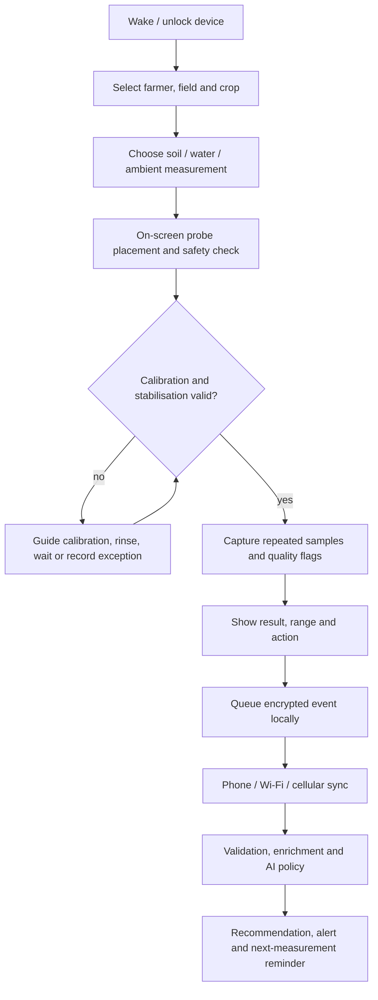

# AgriGrow Agriculture Intelligence Platform — Product Requirements Specification

**Document ID:** AgriGrow-PRD-001  
**Version:** 1.0 | **Status:** Baseline for engineering | **Date:** 2026-07-29

## 1. Product decision

Build **AgriGrow** as a field-measurement ecosystem for Indian agriculture, not a gadget that merely displays sensor numbers. Its hardware is a compatible product family—from an assisted manual soil kit to governed state and national sensor networks—joined by one data contract, AI policy layer, farmer identity/consent model and service system. The system combines field tools, multilingual farmer experiences, governed cloud services, AI decision support, and role-specific dashboards. Its job is to turn a time-stamped, geolocated, quality-scored observation into an explainable action: irrigate, sample again, consult an expert, apply an approved input, or wait.

The first production release, **AgriGrow Field Scout S1**, measures soil/water pH, soil moisture and temperature, conductivity/salinity, ambient temperature/humidity/pressure, light/UV, position, and rain state. Air quality, CO₂, VOC and particulate sensing are optional environmental modules because their inlet geometry, warm-up, calibration and power demand conflict with a small sealed handheld. Wind, optical crop health and chemical assays are accessory or later-generation capabilities.

### Product principles

1. **Truth before prediction.** Every measurement carries units, method, calibration state, uncertainty and quality flags. AI may estimate; it must never relabel an estimate as an instrument reading.
2. **Offline first.** A farmer can finish a measurement campaign with no network; sync is resumable and idempotent.
3. **One-button field flow.** The device is usable with gloves, in sun, by a first-time and elderly user.
4. **Repairable and serviceable.** Probes, battery and port door are replaceable; calibration is scheduled and auditable.
5. **India-scale governance.** Consent, tenancy, regional languages, low bandwidth, data minimisation and programme-level aggregation are core requirements.
6. **One platform, appropriate instruments.** A Tier 0 colour test and a Tier 6 research station can both contribute, but their methods, uncertainty, calibration and permitted uses remain distinct.

## 2. AgriGrow hardware portfolio

The tier is a capability and service designation, not a claim that an observation from a lower tier is interchangeable with a research-grade measurement. Each physical product must publish a measurement profile, calibration protocol, warranty/service level and allowed advisory classes.

| Tier | AgriGrow product | Primary user | Form and purpose | Primary connectivity / data role |
|---:|---|---|---|---|
| 0 | **Soil Test Kit** | First-time users, KVK-assisted use | Manual colourimetric/pH/EC/texture sampling kit with QR protocol; creates labelled observations, not continuous sensing | Phone scan/assisted entry; `manual_test` method |
| 1 | **Pocket Basic** | Marginal farmers | Lowest-cost basic handheld for guided pH/EC/relative moisture and ambient context | BLE-to-phone; low-frequency field checks |
| 2 | **Pocket Smart (Field Scout S1)** | Small farmers | Serviceable pocket device with common soil/water/ambient measurements and GNSS | BLE required; Wi-Fi/cellular variants |
| 3 | **FieldLab Backpack Kit** | Progressive farmers, FPOs, extension workers | Professional portable kit: reference solutions, higher-grade probes, multi-depth accessories and tablet/phone workflow | BLE/Wi-Fi/cellular; campaign and sample-chain workflow |
| 4 | **Solar Farm Tower** | Medium/large farms | Solar, fixed micro-weather and soil/water station with controlled installation | LoRaWAN/cellular backhaul; continuous site time series |
| 5 | **Multi-Tower IoT Network** | Commercial farms, universities, government farms | Multiple towers, wireless probes, edge gateway and approved actuator integrations | Private LoRaWAN/cellular/IP; site/network operations |
| 6 | **Research Sensor Station** | Universities and government labs | Traceable, research-grade sensors, reference instruments and raw-data capture | IP/cellular; reproducible experiment datasets |
| 7 | **District Monitoring Station** | District programmes | Calibrated reference nodes plus programme fleet/aggregation operations | Managed gateway/cloud; district aggregates |
| 8 | **State Agricultural Intelligence Grid** | State departments | Multi-district integration, governance, data stewardship and model deployment plane | Federated APIs and policy-controlled aggregates |
| 9 | **National Agriculture Sensor Network** | National infrastructure | Interoperability, national standards, cross-state intelligence and resilience coordination | Federated—not a monolithic—network of authorised state/programme systems |

### Cross-tier platform contract

- **Identity:** manufacturer device identity and owner/operator relationship; manual Tier 0 kits use batch/kit identity, never impersonate a calibrated electronic device.
- **Observation envelope:** all tiers publish method, units, raw/derived status, UTC/monotonic time, location confidence, calibration/reference status, quality flags and provenance version.
- **Interface profiles:** BLE for portable tools; SDI-12/RS-485/Modbus for professional sensors; LoRaWAN/cellular/IP for stations; versioned cloud APIs at every tier boundary.
- **Safety:** actuator commands are confined to Tier 5+ and require local fail-safe control, human authorisation policy and independent irrigation/fertigation controller validation.
- **Economics:** lower tiers favour shared ownership, rental and assisted service; higher tiers include installation, maintenance, connectivity and calibration in total cost of ownership.

## 3. Problem and target users

| Persona | Need | Primary journey | Design implication |
|---|---|---|---|
| Smallholder farmer | A trustworthy, affordable recommendation | Measure plot → understand plain-language result → act | Guided workflow, voice/local language, no mandatory subscription to view own data |
| FPO / extension worker | Measure many farms consistently | Register campaign → capture samples → review exceptions | Shared device, QR sample ID, role separation, bulk sync |
| Agronomist | Compare field history with crop context | Review quality-scored series → prescribe | Provenance, lab-result attachment, explainable trends |
| Government programme owner | See anonymised and authorised regional signals | Aggregate → threshold alert → plan intervention | K-anonymity threshold, no individual farmer exposure by default |
| Researcher | Reproducible dataset | Discover approved cohort → analyse → cite version | De-identified export, data dictionary, approval workflow |

## 4. Scope and exclusions

### In scope for Release 1

- Field, farm, crop-season and sampling-point registration.
- Quality-controlled handheld measurements and offline storage.
- Bluetooth app pairing; Wi-Fi/cellular backhaul through phone or configured device SKU.
- Recommendations for irrigation, pH/EC risk and resampling, subject to crop/soil/weather inputs.
- Farmer, government and research web experiences with distinct access controls.
- Secure device lifecycle: manufacturing identity, activation, ownership transfer, signed updates and revocation.
- A tiered AgriGrow hardware reference architecture, common telemetry/event model, service/repair model and roadmap from manual kits to national federation.

### Explicitly out of scope

- A cheap probe reporting direct N/P/K, organic carbon, microbial health or heavy metals as laboratory-grade facts. These require validated assay methods and ground-truth programmes.
- Autonomous application of fertiliser, pesticide, irrigation or financial/insurance adjudication.
- Diagnosis that substitutes for a qualified agronomist; the system escalates low-confidence/high-risk cases.
- National data sharing without a programme agreement, legal basis and a documented privacy assessment.

## 5. Requirements

Identifiers use `PRD-F` for functional and `PRD-NF` for non-functional requirements. Detailed allocations appear in subsystem SRSs.

| ID | Requirement | Acceptance measure |
|---|---|---|
| PRD-F-001 | Create a measurement against farmer, field, crop cycle and sampling point. | Required context present or an explicit `unknown` quality flag is stored. |
| PRD-F-002 | Guide measurement by sensor and medium. | Device/app blocks a reading until stabilisation and calibration gates pass or records an override reason. |
| PRD-F-003 | Show result, range, confidence/quality and next action in chosen language. | Usability test: ≥85% of target users complete a guided soil reading unassisted. |
| PRD-F-004 | Operate offline for 30 days or 5,000 observations. | No observation loss during interrupted sync and power cycle tests. |
| PRD-F-005 | Sync securely and de-duplicate retries. | Same event may be uploaded 10 times and yields one canonical observation. |
| PRD-F-006 | Produce advisory with evidence, uncertainty and feedback capture. | Every advisory references model/policy version and input observations. |
| PRD-F-007 | Allow consent, access/export/deletion requests and device ownership transfer. | End-to-end request has auditable state and policy-controlled completion. |
| PRD-F-008 | Accept observations from every supported tier without losing tier, method, calibration or uncertainty context. | Cross-tier conformance suite accepts valid payloads and prevents invalid comparison/aggregation. |
| PRD-F-009 | Permit Tier 5+ actuator workflows only through a declared safety policy and local fail-safe controller. | Network/cloud loss, stale command and unsafe sensor test cases fail closed. |
| PRD-NF-001 | Be practical in Indian field conditions. | Product targets IP54, 0–50 °C operating, 95% RH non-condensing, 1 m packed drop survival. |
| PRD-NF-002 | Protect integrity. | Secure boot, encrypted transport, unique device keys, signed firmware; no shared production credentials. |
| PRD-NF-003 | Scale nationally. | APIs and ingestion partitioned by tenant/region; design target 10 million devices and 100 million observations/day with replay capacity. |
| PRD-NF-004 | Be accessible. | Hindi plus release-state language packs; text, pictogram and optional speech interface meet defined readability tests. |

## 6. End-to-end field workflow

The workflow must ask for *medium* (soil slurry, direct soil, irrigation water, pond water) before pH/EC because a number without method is not comparable. For soil pH, the default agronomy protocol is a labelled, standardised soil-water slurry; a direct insertion reading is stored as a separate method and never mixed into laboratory-comparable trends.

## 7. Success measures and release gates

| Outcome | 12-month metric | Gate |
|---|---|---|
| Measurement reliability | ≥95% of submitted observations pass completeness and plausibility checks | Pilot across at least 3 agro-climatic zones |
| Farmer value | ≥60% of active farmers view at least one recommendation/month | Controlled cohort shows a measurable improvement in timely irrigation/action adherence |
| Data quality | ≥90% of pH/EC events have current calibration metadata | Monthly reference-solution audit |
| Serviceability | Median probe replacement <10 minutes | Technician task test |
| Trust | 100% of advisory events explain model/policy version and input lineage | Release audit |

## 8. Key trade-offs and decisions

| Choice | Options considered | Baseline decision | Upgrade path |
|---|---|---|---|
| pH sensing | Cheap metal probes; replaceable glass/ISFET electrode | Replaceable combination electrode with temperature compensation | ISFET cartridge where cost and validation support it |
| Soil moisture | Low-cost capacitive; TDR/FDR | Interchangeable capacitance/FDR probe with crop/soil calibration curves | TDR accessory for research-grade campaigns |
| Connectivity | Phone-only; embedded cellular; satellite | BLE-to-phone base SKU; cellular SKU for institutional deployments | LoRaWAN where an owned, maintained network exists |
| Air quality | Built in; accessory | Vented environmental accessory | Fixed station for defensible AQ trends |
| Display | OLED; e-paper; memory-in-pixel LCD | Sunlight-readable MIP LCD | Larger display only on extension-worker model |

## 9. Traceability and governance

Every subsystem requirement must link to this document, an owner, verification method and release evidence. Engineering changes that affect measurement method, sensor lot, calibration, model outputs or data retention require a versioned change record and impact assessment. The platform shall retain raw observations; derived values are reproducible from immutable source events, calibration version and algorithm version.
