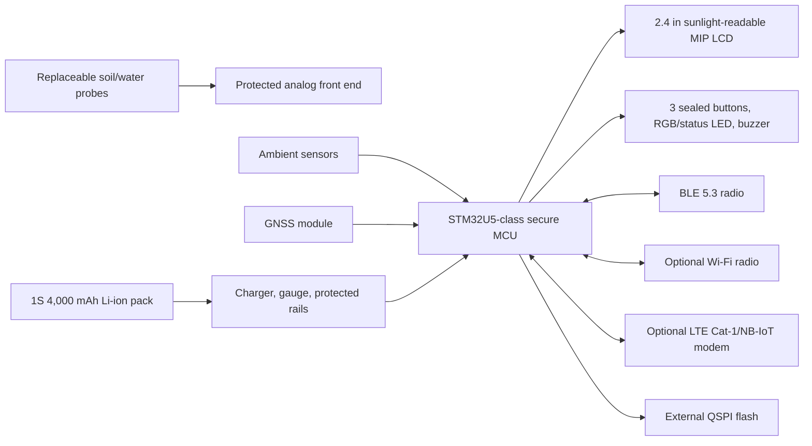

# AgriGrow Hardware Ecosystem and Field Scout S1 — Hardware System Requirements Specification

**Document ID:** AgriGrow-HW-SRS-002 | **Version:** 1.0 | **Applies to:** Base, Environmental and Cellular SKUs

## 1. Hardware platform reference architecture

AgriGrow is a modular hardware platform. Field Scout S1 is the Tier 2 reference product, not the whole hardware strategy. Lower tiers reduce entry cost and increase assisted adoption; upper tiers increase installation quality, continuous coverage, accuracy assurance and operating discipline. They share data semantics and lifecycle controls, not necessarily the same electronics or enclosure.

| Tier | Product configuration | Measurement / control boundary | Planning cost band (INR, ex-GST) | Ownership and service model |
|---:|---|---|---:|---|
| 0 | Soil Test Kit: labelled sampling tools, colour comparator/strips, sample QR and phone guide | Human-read manual results; no claim of instrument precision | COGS 350–900; retail 900–2,000 | KVK/FPO-assisted, replenishable consumables |
| 1 | Pocket Basic: single low-cost MCU/BLE, display or phone UI, pH/EC and relative moisture accessories | Basic spot checks; readings are explicitly method-labelled | COGS 2,500–4,500; retail 4,500–8,000 | Farmer, cooperative pool, rental/subsidy candidate |
| 2 | Pocket Smart / Field Scout S1 | Validated spot soil/water/ambient measurements, GNSS and local records | COGS 8,400 target at 10k; retail 13,000–20,000 | Farmer/FPO; replaceable battery/probes |
| 3 | FieldLab Backpack Kit: rugged tablet/phone dock, reference kit, multi-depth probes, water module, optional camera | Professional campaign sampling; chain-of-custody and reference checks | COGS 20,000–45,000; deployed price 35,000–70,000 | FPO/extension/rental; technician-maintained |
| 4 | Solar Farm Tower: solar/battery, weather mast, soil/water probes, logger and backhaul | Fixed continuous sensing; no actuator control by default | COGS 50,000–100,000; installed price 0.9–2.0 lakh | Farm subscription with installation and annual service |
| 5 | Multi-Tower IoT Network: towers, wireless probes, LoRa gateway, edge gateway, camera/irrigation integration | Site-network observations and supervised actuator requests | Project-scoped; 5–50 lakh typical planning envelope | Enterprise O&M contract; commissioned by trained installer |
| 6 | Research Sensor Station | Traceable research instruments, reference sensors, raw capture and controlled experiments | Project-scoped; 8–30 lakh+ | University/lab calibration and data steward |
| 7 | District Monitoring Station | Reference nodes, district gateway/ops kit and programme fleet support | Programme-scoped; 25 lakh–1 crore+ | District programme with accredited service partner |
| 8 | State Agricultural Intelligence Grid | Federation/control-plane integration, not a single physical product | Programme-scoped | State data steward and SRE/security operations |
| 9 | National Agriculture Sensor Network | Standards, federation and resilience across authorised grids | Programme-scoped | National coordination; no direct farmer surveillance function |

Cost bands are planning hypotheses for design and ownership decisions, not quotations, tender prices or subsidy commitments. They include neither tax nor every state-specific installation/civil/connectivity cost. Each business case must validate local labour, service, financing, radio coverage and procurement volume.

### Common hardware contracts

| Contract | Requirement |
|---|---|
| Measurement profile | Every sensor/product advertises parameter, method, range, units, sample medium/depth, raw/derived status, stated uncertainty, calibration/reference state and quality flags. |
| Identity and lifecycle | Electronic products use unique cryptographic identity, SKU/hardware revision, test record, ownership state and revocation. Tier 0 uses kit/batch/expiry identity only. |
| Physical interfaces | Tier 1–3 use a keyed, sealed, low-voltage accessory interface; Tier 3–7 expose documented SDI-12 and/or RS-485/Modbus through surge-protected industrial connectors. No unverified analogue accessory may identify itself as a calibrated probe. |
| Timing/location | Record UTC, monotonic capture time, time-source confidence and location/HDOP or installation coordinates. Stations additionally record mast/probe depth and installation geometry. |
| Data transport | BLE for portable products; LoRaWAN/cellular/IP for towers; MQTT/HTTPS or approved equivalent with device authentication. Transport may change; event schema and quality semantics must not. |
| Power | Portable: protected 1S Li-ion and USB-C. Stations: protected LiFePO₄/solar power domain with energy budget, low-temperature/high-temperature charge controls, lightning/surge earth design and battery service plan. |
| Service | QR-visible serial/probe/service instructions, replaceable consumables, calibration schedule, maintenance logs and an explicit end-of-support policy. |

### Supporting modules and control boundary

| Module | Tiers | Baseline design rule |
|---|---|---|
| Wireless soil probe / water-quality module | 3–6 | Use installation depth, soil/contact and probe calibration metadata; wire via SDI-12/RS-485 where cabling is practical, otherwise long-life low-duty radio. |
| Weather/camera/disease scouting module | 3–6 | Weather sensing has a specified siting/mast protocol; camera data is labelled as evidence, with privacy zone/masking controls. |
| Solar charger, dock, vehicle charger, external pack | 1–4 | USB-C portable accessories must negotiate only supported power; tower solar uses fused, serviceable charge controller and lightning protection. |
| LoRa gateway / edge AI gateway | 4–7 | Gateway forwards authenticated data; it does not become a hidden cloud root. Edge models are signed, versioned and fail safely on stale inputs. |
| Smart irrigation, valve, pump and fertigation controller | 5+ | A separate safety-rated local controller owns actuation. Cloud/AI sends bounded, expiring requests; manual override, interlocks, flow/pressure feedback and fail-closed behaviour are mandatory. |
| Drone dock and future robotics | 5+ future | Integrate through authenticated mission/data APIs only; no safety-critical control is implied by current AgriGrow sensor products. |

## 2. Field Scout S1 system architecture

The base design uses an ultra-low-power Arm Cortex-M33 MCU with TrustZone, hardware crypto, ≥2 MB flash and ≥768 KB RAM; the production selection is frozen only after radio module, supply and security review. A discrete BLE module reduces RF certification and antenna risk. Wi-Fi and cellular are SKU options rather than an always-powered design. This is more serviceable and energy-efficient than a Linux SBC, while remaining sufficient for guided workflows, local rules and lightweight on-device anomaly detection.

## 3. Field Scout S1 mechanical and industrial design

| Attribute | Requirement / decision |
|---|---|
| Envelope | Target 155 × 76 × 28 mm; ≤300 g including battery, excluding long probe accessory. One-handed grip, lanyard point and flat rear surface. |
| Enclosure | UV-stabilised PC+ABS outer shell with TPE overmould at grip and bumper zones; 316 stainless fasteners into brass inserts. Avoid exposed zinc-plated steel. |
| Protection | Target IP54 complete product; probe connectors achieve IP67 only when mated/capped. Do not claim immersion resistance. Hydrophobic acoustic membrane over vented sensors. |
| Display | 2.4–2.7 in transflective memory-in-pixel LCD, front light, 320×240 minimum. OLED is rejected for sunlight current draw and burn-in; e-paper is too slow for live stabilisation. |
| Controls | Power/back, context/select, primary capture; tactile force 1.5–3 N, 12 mm minimum centre spacing. No touchscreen is required for the core workflow. |
| Audio/indication | Piezo buzzer for completion/error; optional small speaker/mic on voice SKU. RGB LED is supplemental—not the sole status signal. |
| Service | Captive rear screws, gasketed battery door, keyed replaceable probe lead, QR serial label under door and tamper-evident calibration sticker. |

**Placement rules:** keep temperature/RH, pressure and VOC inlet away from PMIC, display backlight and user hand; isolate particulate inlet/exhaust from rain/drip path; put GNSS and 2.4 GHz antennas at opposite enclosure ends with RF keep-outs; separate high-impedance pH traces from radio, switching converters and display flex. Soil probe leads are shielded and strain-relieved.

## 4. Field Scout S1 measurement subsystem

| Measurement | Recommended method / candidate | Production requirement | Caveat and calibration |
|---|---|---|---|
| pH, water/soil slurry | Replaceable double-junction combination electrode + high impedance AFE | 0–14 pH, 0.01 pH display; field accuracy target ±0.10 pH after calibration | 2- or 3-point buffers pH 4.01/7.00/10.01; temperature compensated; store slope/offset/expiry. |
| EC/TDS/salinity | 4-electrode conductivity cell + AC excitation | 0–20 mS/cm, ±2% reading target | K-cell constant and reference solution calibration. TDS is an indicated conversion factor, not directly measured. |
| Soil moisture | Interchangeable FDR/capacitance probe; probe-specific curve | Relative wetness plus calibrated VWC target ±3–5% VWC for validated soils | Soil texture, salinity, compaction and insertion affect output. Use gravimetric ground truth for each model/region. |
| Soil temperature | Stainless probe RTD/NTC near moisture sensor | ±0.5 °C after verification | Two-point check; allow equilibrium before read. |
| Ambient T/RH | Digital sensor in shielded vent (e.g., SHT4x class) | ±0.3 °C, ±2% RH typical component target | Solar heating and hand warmth require shaded, timed sampling. |
| Pressure | Digital barometer (BMP390-class) | ±1 hPa system target | Field trend, altitude compensated. |
| Light / UV | Calibrated ALS/UV photodiode behind UV-stable window | Lux and UV index shown with sensor range flag | Window ageing and orientation matter; not a radiometric crop research instrument. |
| Rain | Capacitive rain plate | Wet/dry indication only | Must not present rainfall depth. Self-test for contamination. |
| GNSS | Multi-constellation module with patch antenna | ≤5 m CEP typical open-sky target; record HDOP | Do not infer field boundary from poor-fix location. |
| CO₂/VOC/PM | Vented NDIR/MOX/laser particulate accessory | Optional, explicitly warmed-up/quality flagged | Not for regulatory AQI claims; PM module requires controlled inlet and periodic cleaning. |

### pH and EC analog design requirements

- Use a guarded, low-bias-input electrometer front end; board cleanliness and conformal-coating exclusion around the high-impedance node are mandatory.
- Excite conductivity with a bipolar AC waveform to avoid electrode polarisation. Measure current and voltage synchronously, apply cell constant and temperature normalisation at a documented reference temperature.
- Add ESD/EMI protection selected for leakage rather than generic high-capacitance TVS components. Specify leakage at operating temperature and test it.
- Each probe reports type, serial, lot and calibration coefficients through an EEPROM/one-wire identity or verified QR registration. Unknown probes enter a limited, labelled mode.

## 5. Field Scout S1 electronics, PCB and power

| Area | Requirement |
|---|---|
| PCB | 6-layer main board: solid GND reference, segregated analog island, controlled RF impedance, no signal return across splits; ENIG finish. A separate small sensor/probe board is preferred for revision/service isolation. |
| EMC | Input surge/ESD at USB and probe interfaces, common-mode filtering where validated, shield-can footprint over RF and sensitive AFE, pre-compliance scans before tooling release. |
| Battery | Certified 1S 3.7 V nominal, 4,000 mAh Li-ion pouch with pack protection and NTC; target 14.8 Wh. Use removable pack only if enclosure safety and connector cycle life pass qualification. |
| Charging | USB-C receptacle, 5 V sink default (no USB-PD required), power-path charger, JEITA temperature limits, gauge and ship mode. Charge 0–45 °C only. |
| USB-C | CC resistors, over-voltage protection, ESD, USB 2.0 data or protected debug disabled in production. Clearly label supplied 5 V charger rating. |
| Storage | ≥16 MB authenticated/encrypted QSPI NOR plus internal flash; store 5,000 full events minimum, then warn and preserve oldest un-synced data. |
| Energy | Baseline budget: sleep ≤150 µA at battery, guided measurement ≤120 mA average, BLE sync ≤35 mA average, modem bursts decoupled with low-ESR bulk capacitance. A 14.8 Wh pack yields roughly 80+ guided 5-minute sessions under the stated assumptions; validate in chamber and real network conditions. |

## 6. Communications decision

Bluetooth LE is mandatory for phone pairing and low-cost backhaul. Wi-Fi is optional for FPO/office environments. Cellular is an institutional SKU using a region-certified module and eSIM/nano-SIM management; choose Cat-1 bis where continuous broad coverage is needed, and enable NB-IoT only after operator/network validation in target districts. LoRaWAN is a private-network option, not a national connectivity promise. Every SKU must isolate and power-gate unused radios.

## 7. Component trade-offs and recommended baseline

### Compute and radio selection

| Option | Strength | Constraint | Decision |
|---|---|---|---|
| ESP32-S3/C6 class single-chip | Low cost, strong ecosystem, integrated Wi-Fi/BLE | Higher active/sleep power and a more complex security/RF trade-off for precision analogue measurement | Suitable for a cost-down Wi-Fi accessory, not preferred core controller. |
| Nordic nRF53 class | Excellent BLE and low power, strong secure update support | Requires a Wi-Fi/cellular companion; analogue/peripheral fit depends on chosen variant | Good radio co-processor choice. |
| STM32U5-class MCU + certified BLE module | Low-power Cortex-M33/TrustZone, mature industrial peripherals, clean partition between compute and RF | More BOM components and integration work | **Recommended S1 baseline.** Use a production-qualified STM32U5-class part plus BLE module; freeze exact MPN after supply/RF review. |
| Linux SOM | Rich UI/edge ML | Boot time, power, cost, update attack surface and field reliability are excessive | Reject for handheld S1; consider only gateway/vision products. |

| Link | Use | Trade-off | Baseline |
|---|---|---|---|
| BLE 5.x | Pairing, live view, phone backhaul | Depends on phone proximity | **Required** |
| 2.4 GHz Wi-Fi | FPO office/home bulk sync | Power and captive-network complexity | Optional module/SKU |
| LTE Cat-1 bis | Direct wide-area service | SIM lifecycle, certification, monthly cost, burst power | Institutional SKU |
| NB-IoT | Small intermittent packets | Coverage/operator availability must be proven per district | Conditional option |
| LoRaWAN | Partner-owned rural network | No guaranteed public network; gateway operations | Project deployment option |

### Sensor selection rationale

| Function | Candidates compared | Recommended baseline | Why / upgrade path |
|---|---|---|---|
| pH | Low-cost antimony/metal “soil pH” rod; consumer glass electrode; industrial double-junction electrode; ISFET | Replaceable double-junction glass combination electrode | The rod is not defensible for broad field accuracy. Glass has known protocol/maintenance; ISFET becomes an upgrade after cost, drift and chemical compatibility validation. |
| EC | Two-electrode DC; two-electrode AC; four-electrode AC | Four-electrode AC cell | Best operating range and polarisation resistance for field use; retain temperature and cell-constant metadata. |
| Moisture | PCB capacitive fork; low-cost coated capacitive probe; FDR; TDR | FDR/capacitance probe with region-specific calibration | Cheap forks drift and are severely installation-dependent. TDR offers better research performance but cost/energy/geometry suit an accessory. |
| Ambient T/RH | Low-cost unshielded integrated sensor; industrial digital T/RH in vented chamber | SHT4x-class digital sensor in shielded vent | Mechanical airflow and thermal isolation matter as much as component accuracy. |
| CO₂ | Estimated eCO₂ MOS; NDIR | NDIR accessory only | Never label MOS estimate as CO₂. NDIR needs power, warm-up and vent design. |
| PM2.5/PM10 | Tiny fanless optical sensor; laser scattering module; fixed station | Vented laser-scattering accessory | A sealed pocket housing cannot produce defensible particulate data without a managed inlet and cleaning plan. |
| GNSS | Phone-only; single-band GNSS; RTK | Multi-constellation single-band GNSS | Appropriate for sampling-point attribution; RTK is a survey accessory, not S1 need. |

### Frozen S1 baseline configuration

`Secure Cortex-M33 MCU + BLE module + 16 MB QSPI NOR + 2.4 in MIP LCD + 4,000 mAh 1S Li-ion + USB-C 5 V charger + multi-constellation GNSS + vented T/RH/pressure/light/UV sensors + replaceable pH and four-electrode EC probes + calibrated moisture/soil-temperature probe.`

Environmental gas/PM, Wi-Fi and cellular are electrically/mechanically provisioned but are BOM-optional SKUs. This is intentional: it permits a serviceable base device at scale while preventing unvalidated sensing modules from setting the product's reliability and cost.

## 8. Calibration, reliability and safety

| Item | Requirement |
|---|---|
| Calibration gate | Warn at 80% of interval; prevent `validated` status after expiry unless operator records approved override. pH: daily/weekly by use intensity; EC: monthly/after probe change; moisture: seasonal regional programme. |
| Self-tests | At boot and before capture: battery, RTC, storage, probe identity, sensor bus, AFE range, calibration age, radio identity; persist failures. |
| Environmental | 0–50 °C operation, −20–60 °C storage, 10–95% RH non-condensing, 1 m packed drop, vibration transport test, UV and sweat/chemical exposure tests. Validate final limits by SKU. |
| Lifecycle | 3-year device design life; 500 battery charge cycles to ≥80% nominal capacity; 12-month limited warranty baseline; pH electrode is consumable. |
| Certification plan | Build a country/SKU compliance matrix before PVT: electrical safety, EMC/radio, battery transport, WPC/ETA and applicable TEC/MTCTE/BIS requirements must be confirmed with an accredited lab and the current notified lists. BIS notes that compulsory status depends on notified categories; TEC publishes current IoT/MTCTE material. [BIS](https://www.bis.gov.in/product-certification/products-under-compulsory-certification/?lang=en) · [TEC IoT](https://www.tec.gov.in/internet-of-things-iot) |

## 9. Preliminary ex-factory BOM target (10k units, INR, excluding GST)

| Assembly | Target INR | Notes |
|---|---:|---|
| MCU, BLE, memory, PMIC, passives | 1,450 | Alternate-qualified parts only |
| Display, UI, audio | 700 | MIP display is strategic component |
| Base ambient / GNSS sensors | 1,300 | Excludes premium gas/PM sensors |
| pH/EC/moisture probe kit | 2,200 | Replaceable; quality dominates outcome |
| Battery, USB-C, antenna | 650 | Includes protection and pack test |
| PCB, assembly, test | 1,150 | 6-layer board, fixtures amortised separately |
| Enclosure, gasket, hardware, pack | 950 | Tooling excluded |
| **Base COGS target** | **8,400** | Pilot cost will be materially higher |

The target is a procurement hypothesis, not a quote. PVT must include multi-source availability, MOQ, lead time, FX exposure, incoming inspection criteria and approved alternates.

## 10. Hardware verification evidence

Release requires schematics/layout review, DFM/DFT review, tolerance analysis, calibrated-reference comparison, HALT/HASS plan, ingress and drop evidence, RF/EMC pre-scan, battery abuse/transport evidence, manufacturing test coverage ≥95% of testable faults, and a signed residual-risk register. Failure modes include contaminated probe, cable break, condensation, battery swelling, radio brownout, false moisture due to salinity, GPS multipath and accidental cross-farm attribution; each maps to detect/contain/recover behaviour in the validation plan.

## 11. External benchmark and design implications

AgriGrow should learn from proven product categories without copying unverified claims. CropX demonstrates the practical value of pairing soil sensors, telemetry, weather and farm-management software; Arable demonstrates a fixed solar/cellular, multi-signal station with an integrated camera; METER's TEROS range shows why installation geometry, high-frequency sensing, repeatability checks and long-lived rugged probes matter for serious soil programmes. [CropX hardware](https://cropx.com/hardware-setup/) · [Arable Mark 3](https://www.arable.com/mark3/) · [METER TEROS](https://metergroup.com/products/teros-12/)

The AgriGrow differentiation is a tiered India-first service model: assisted entry at Tier 0/1, serviceable handhelds at Tier 2/3, maintainable solar stations at Tier 4/5, and governed public-interest federation at Tier 7–9. Benchmark products inform requirements; any claimed accuracy, environmental rating, lifetime or price for an AgriGrow product must be independently verified in its own release evidence.
