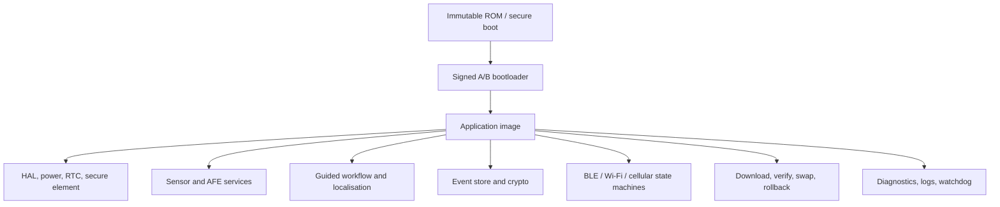

# AgriGrow Field Scout S1 — Embedded Firmware SRS

**Document ID:** AgriGrow-FW-SRS-003 | **Version:** 1.0

## 1. Architecture and execution model

Use a small RTOS (FreeRTOS or Zephyr after platform evaluation), not bare metal. Independent drivers, measurement orchestration, storage, connectivity and OTA need deterministic priorities, timeouts, memory boundaries and test seams. The firmware contains no agronomy model that cannot be independently updated and audited; it applies local safety/interlock rules and renders cached, signed advisory bundles.

### Task policy

| Task | Priority | Rule |
|---|---|---|
| Watchdog/health, power fault | highest | Never waits on I/O; moves to safe state. |
| AFE sampling / probe excitation | high | Timer-driven, bounded CPU time, radio quiet window if required. |
| Sensor acquisition | high | Rejects stale/unstable samples and emits quality reason. |
| UI workflow | medium | Remains responsive during sync. |
| Event persistence | medium | Append-only encrypted record before user success indication. |
| Radio / sync | low | Exponential backoff and resume token; fully power-gated when idle. |
| Telemetry/log upload | lowest | Rate limited and never blocks measurements. |

## 2. Measurement state machine

`IDLE → CONTEXT → PRECHECK → CONDITIONING → STABILISING → SAMPLING → VALIDATING → COMMITTING → RESULT`.

Each transition has a timeout and a human-readable recovery action. `PRECHECK` validates probe identity, calibration expiry, battery, storage, sensor communication and medium. `STABILISING` uses a sensor-specific slope/variance window rather than a fixed delay. `VALIDATING` calculates median of repeated samples, detects outliers, attaches quality flags, and distinguishes `valid`, `provisional`, `invalid`, `overridden` and `estimated`. A raw ADC trace or diagnostic summary is retained for service according to privacy policy.

## 3. Data model and storage

An observation is an immutable CBOR event containing UUIDv7 event ID; device ID; monotonic sequence; UTC and confidence; field/sampling-point pseudonymous IDs; measurement method; raw and derived values; units; sensor/probe/firmware/calibration versions; quality flags; actor role; and a cryptographic signature/MAC. Store files in encrypted, append-only segments with CRC, sequence number and atomic two-phase commit. Maintain a separate encrypted index for unsynced events. On corruption, mount read-only, recover to last verified segment, preserve evidence and show a service code.

Compression is batch-level (CBOR + heatshrink/deflate where profitable), never applied before data integrity validation. The sync protocol is idempotent: server acknowledgement contains event IDs and durable cursor; retries may reorder but may not alter an event. Clock changes create an audit event; measurements use both RTC UTC and monotonic elapsed time.

## 4. Security requirements

- Enable hardware read-out protection, TrustZone/secure storage and production debug lock. A factory service unlock must be time-bound, signed, logged and physically controlled.
- Root trust begins in immutable boot code. Bootloader and images use asymmetric signatures; versions enforce anti-rollback except an authorised recovery image.
- Generate or inject a unique device private key in a controlled manufacturing step; protect it in secure element/secure enclave where selected. Never derive it from serial number.
- Use mutually authenticated TLS 1.3 where supported; pin trust anchors with controlled rotation. BLE pairing uses authenticated LE Secure Connections and a QR out-of-band binding code.
- Encrypt local event store with a per-device key hierarchy. Deletion/ownership transfer cryptographically destroys field-data keys only after platform confirmation and retention-policy checks.

## 5. OTA and recovery

Use A/B image slots and a small immutable recovery path. Device downloads only a manifest signed by release keys; it validates model/SKU/hardware revision, image hash, signature, minimum bootloader and power/storage thresholds before staging. After first boot it runs health checks and confirms within 10 minutes; otherwise bootloader rolls back. Delta updates are optional only after full-image reliability is proven. Updates are deferred during a measurement, low battery, metered data policy, or scheduled farming hours, except a critical security campaign approved by policy.

## 6. Performance, diagnostics and testability

| Requirement | Target |
|---|---|
| Cold start to usable UI | ≤3 seconds typical |
| Sensor capture loss | 0 committed events in power-cut fuzz test |
| Base firmware idle | Meet hardware sleep budget with radios off |
| Crash handling | Capture compact fault record, reset safely, no secret/log dump over UI |
| Test | Unit tests for parsers/conversions; hardware-in-loop driver tests; fault injection for I²C, flash, battery and network loss; static analysis and SBOM in CI |

Firmware logs use event codes and redacted IDs. A field technician receives a QR diagnostic package only after farmer consent or authorised organisation policy; raw personal data is not included by default.
