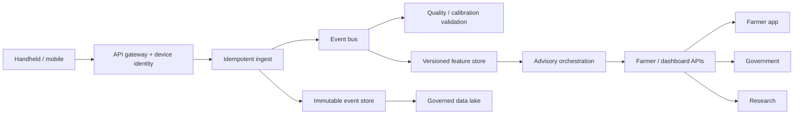

# AgriGrow Cloud Backend — System Requirements Specification

**Document ID:** AgriGrow-CLD-SRS-005 | **Version:** 1.0

## 1. Responsibilities and boundaries

The cloud is the canonical, governed record of events and policies; it is not allowed to silently “clean” raw measurements. It authenticates actors/devices, ingests immutable observations from Tier 0 manual kits through Tier 9 federation, validates schemas and lineage, runs asynchronous enrichment/advisory workflows, serves applications, and produces policy-governed aggregates. It does not make irreversible financial, insurance, pesticide or fertiliser decisions without a separately approved human process.

## 2. Domain and API requirements

Core entities are `Person/Organisation`, `Consent`, `Farm`, `Field`, `CropCycle`, `SamplingPoint`, `Device`, `Probe`, `Calibration`, `Observation`, `LabResult`, `Advisory`, `ModelVersion`, `Campaign`, `DataAccessGrant`, and `AuditEvent`. Identifiers exposed across tenant boundaries are opaque UUIDs; location and farmer identity are separate protected attributes.

| ID | Requirement |
|---|---|
| CLD-F-001 | Accept a versioned observation envelope with `event_id`, producer sequence and schema version; return durable acknowledgement only after canonical persistence. |
| CLD-F-002 | Deduplicate by producer/event ID and preserve conflicting payloads as security events, never last-write-wins. |
| CLD-F-003 | Validate units, method, calibration/probe state, timestamp plausibility, location confidence and field authorisation; append flags rather than alter raw data. |
| CLD-F-004 | Enforce tenant, purpose, consent and role policy at every data query, export and model feature read. |
| CLD-F-005 | Provide a human- and machine-readable provenance chain for every advisory. |
| CLD-F-006 | Support correction/supersession events, legal hold and retention policy without physically rewriting retained source events. |
| CLD-F-007 | Preserve product tier, measurement profile and commissioning/install context through every derived dataset, query and advisory. |

Public APIs are HTTPS JSON for management/query and a compact CBOR/protobuf endpoint for device/mobile ingestion. Version APIs with explicit deprecation windows; publish OpenAPI/AsyncAPI contracts; issue short-lived OAuth2/OIDC access tokens scoped to audience, action, tenant and purpose. Use a server-side idempotency key for all state-changing management endpoints.

## 3. Data architecture, scale and reliability

Use a relational transactional store for identity, consent and operational records; object storage plus immutable columnar lake for raw/event history; time-series/OLAP store for authorised aggregates; and a versioned feature store for models. Partition event streams by tenant/region and hash of device/field, retain ordering per producer only. Store raw payload, normalised payload and validation result together with schema parser version.

Design target: 10 million registered devices, 100 million events/day, peak ingest 10,000 events/s and replay of one day within 12 hours in a regional outage recovery exercise. These are capacity-planning targets, not a claim of achieved scale. Multi-AZ operation, point-in-time backups, cross-region encrypted backups, infrastructure-as-code, queue back-pressure and dead-letter replay are mandatory. Service objectives: ingest durable-ack availability 99.9% monthly; RPO ≤15 minutes for operational stores; RTO ≤4 hours for critical farmer/device paths. Publish honest degradation behaviour when an AI or analytics dependency is unavailable.

## 4. Data quality pipeline

Validation is staged: (1) authenticated schema/unit bounds, (2) device/probe/calibration and temporal checks, (3) contextual plausibility such as repeated values or impossible crop stage, (4) cross-signal anomaly detection, (5) human/lab reconciliation. A failed stage produces a labelled, queryable quality state—not data deletion. Models use only an explicit allow-list of quality states. Data stewards can amend an interpretation through a new signed annotation event.

A Tier 0 manual observation may support farmer education or local trend context, but it cannot satisfy a Tier 6 reference-instrument feature contract. A Tier 4 station datum includes site/mast/probe geometry and maintenance state; it must not be treated as an arbitrary mobile spot reading. Aggregation, model training and dashboard comparison enforce these profile boundaries.

## 5. Operations and delivery

Separate dev, test, staging and production accounts/projects; no production personal data in lower environments. CI requires tests, dependency/SBOM scan, schema compatibility, threat-model check for sensitive changes and deployment approval. Canary releases use observable business and safety metrics, automatic rollback and migration compatibility. Central logs redact personal data and secret material; audit logs are append-only with independent retention. Incident runbooks cover device credential compromise, corrupted calibration batch, regional outage, erroneous advisory, data-subject request and model rollback.

## 6. Acceptance evidence

Contract, load, replay, chaos, backup-restore, authorization-negative, cross-tenant isolation, privacy request, observability and disaster-recovery tests are release gates. A synthetic “golden farm” dataset with known measurements must flow device-to-dashboard through every deployment without being used for production advisory.
