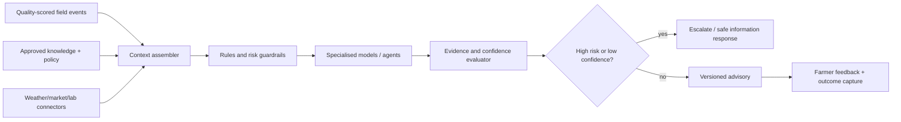

# AgriGrow AI Agent System — System Requirements Specification

**Document ID:** AgriGrow-AI-SRS-006 | **Version:** 1.0

## 1. Purpose and safety boundary

The AI system converts validated observations, farmer context, approved agronomy knowledge, weather and market signals into understandable options. It is an advisory orchestration system, not an autonomous farm controller or a substitute for an agronomist. High-stakes recommendations must be bounded by policy, cite their inputs/sources, expose uncertainty, and route unsupported cases to a qualified person or an information-only response.

## 2. Agent architecture

Specialised services may include irrigation timing, pH/EC risk interpretation, crop-stage reminders, weather/disaster alerts, market information retrieval, scheme eligibility pre-screening and multilingual explanation. A language model may explain a policy-approved conclusion but may not invent a dosage, diagnosis, scheme entitlement or sensor reading. Tool calls are allow-listed, typed, rate-limited and policy-checked.

### Cross-tier intelligence rule

All tiers feed the same governed intelligence layer, but not the same model feature set. Each input carries hardware tier, measurement profile, method, calibration/reference state, installation context and quality flags. Feature contracts explicitly define eligible tiers: for example, a district climate trend may use commissioned Tier 4/7 stations, a research calibration study may use Tier 6 references, and a farmer explanation may include a Tier 0 result only as a manually read screening observation. This prevents a large quantity of low-cost data from washing out fewer, better-controlled measurements.

## 3. Requirements

| ID | Requirement |
|---|---|
| AI-F-001 | Build an advisory from a declared feature contract that records source event IDs, units, quality states, crop/location/time context and missing inputs. |
| AI-F-002 | Attach advisory type, model/rule/knowledge version, confidence, expiry, language, safety class and evidence summary. |
| AI-F-003 | Distinguish observations, derived estimates, forecasts and general guidance in both API and UI. |
| AI-F-004 | Prevent direct action instructions where policy needs local expert approval; show escalation contact/next measurement instead. |
| AI-F-005 | Evaluate performance by agro-climatic zone, crop, language, farm-size proxy and data completeness; monitor disparity and drift. |
| AI-F-006 | Allow a human agronomist to annotate, override, withdraw and appeal an advisory; preserve original version and reason. |

## 4. Model lifecycle and evaluation

Each use case requires a model card: intended decision, users, training/validation data lineage and permissions, label definition, regional/crop applicability, known failure modes, fairness analysis, uncertainty method, thresholds, monitoring and rollback owner. Split data by farm and time to avoid leakage. Evaluate pH/EC/irrigation recommendations against independent lab/field outcomes rather than engagement. Shadow mode precedes farmer exposure; an approved release registry controls activation.

For generative explanation, retrieve only curated, versioned content and validate generated output against a structured advisory schema. Reject unsupported numerical claims and unsafe/contradictory text. Prompt injection from farmer-entered notes, web content and connector output is treated as untrusted input. Save minimal redacted traces necessary for safety review; never use farmer data to train a general model without documented lawful basis and consent/policy.

## 5. Decision policy

Confidence is a combination of sensor quality, calibration freshness, contextual coverage, model uncertainty and applicability. Below threshold, say what is missing and offer a measurement or expert referral. For example, soil moisture measured at unknown depth may support “soil at this point appears drier than your recent readings,” but not a hectare-wide irrigation prescription. Weather/market outputs carry timestamp, provider and forecast horizon; they are never represented as observed fact.

## 6. Monitoring and incident control

Monitor input drift, missingness, calibration failure correlation, inference latency/cost, tool failure, unsafe-output blocks, human override rate, outcome feedback and complaint rate. A kill switch can disable a model/advisory type per region without interrupting raw data collection. Any material erroneous advisory triggers triage, affected-user identification, corrective notification where appropriate, model/policy rollback, root-cause analysis and documented release gate update.
