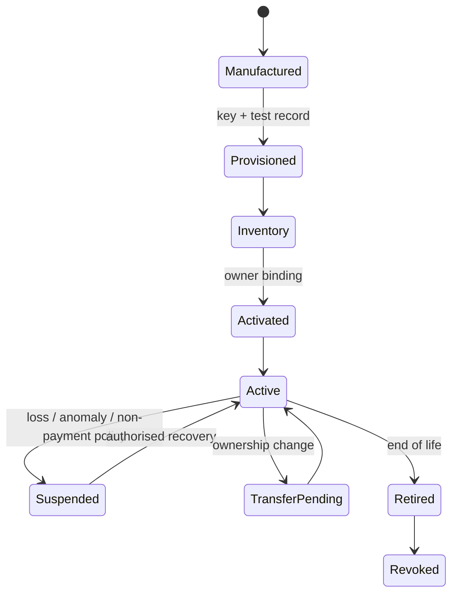

# AgriGrow IoT Data Platform — System Requirements Specification

**Document ID:** AgriGrow-IOT-SRS-011 | **Version:** 1.0

## 1. Tier-aware identity and commissioning

The registry treats product tier as an immutable capability profile, not a marketing label. Policy uses it to decide which observation types, calibration claims, data-retention options, connectivity paths and control requests are permitted.

| Tier family | Registry / commissioning requirement | Data/control restriction |
|---|---|---|
| 0 manual kits | Kit batch, expiry, protocol version and assisted operator/app identity | Results are `manual_test`; never included in calibrated-sensor accuracy metrics. |
| 1–3 portable | Device certificate, probe/accessory identities, owner/operator and mobile pairing | Store-and-forward; only local, non-actuating workflows. |
| 4 fixed tower | Site survey, station coordinates, mast height, sensor depth/orientation, power/earthing, installation photos and installer attestation | Continuous data needs time-sync, missing-data/maintenance flags and site lifecycle. |
| 5 network/actuation | Gateway inventory, radio plan, topology, actuator safety controller, valve/pump mapping and commissioning witness | Command path is isolated from telemetry; no cloud-to-actuator bypass. |
| 6 research station | Traceability IDs, calibration certificates, reference instrument/experiment metadata | Raw and processed channels retained distinctly. |
| 7–9 programme/federation | Authorised tenant, programme purpose, geography scope, data-sharing agreement and accountable steward | Aggregate/federated access by default; no transitive individual access. |

Commissioning must be repeatable: create site/asset record → verify manufacturing/test/provisioning evidence → install and photograph geometry → execute sensor/reference and radio/power tests → sign acceptance → start health baseline. A moved tower is recommissioned; it is not merely given a new map point.

## 2. Device lifecycle

Device registry stores immutable hardware identity, public key/certificate, SKU/revision, radio identifiers, manufacturing batch/test results, SBOM/firmware compatibility, ownership state, calibration/probe associations and revocation status. It must never store a production device private key.

## 3. Telemetry and event contract

Separate **observations** (farmer-relevant measurements) from **telemetry** (battery, reset reason, sensor health, network) and **audit events** (pairing, transfer, calibration, firmware). Default telemetry is minimal, batched and purpose-limited. Event envelope fields: schema version, event UUID, producer ID/sequence, UTC/monotonic time, payload, integrity tag, compression flag and data classification. Schema registry prevents incompatible producers/consumers; unknown optional fields are preserved but not interpreted.

## 4. Connectivity and sync

BLE uses an authenticated GATT protocol with message MTU negotiation, chunk sequence/CRC, flow control and resumable upload. Mobile is the normal gateway. Direct Wi-Fi/cellular uses mutual TLS, certificate rotation and store-and-forward queues. Radio connectivity is a best-effort transport: a measurement commits locally before transport; server acknowledgement permits safe deletion only after retention window. Backoff has jitter and regional throttles to avoid a reconnect storm after outage.

## 5. Fleet operations

Fleet console shows aggregate firmware adoption, battery/probe/calibration health, crash/reset rates, radio success, queue depth and suspicious identity events. It does not expose farmer raw data to operations by default. Campaigns target immutable predicates (SKU, bootloader, region, health, ownership consent state), stage by percentage, observe health metrics, pause automatically and provide rollback. Remote commands are signed, TTL-bound, allow-listed and require device acknowledgement; no arbitrary shell/firmware execution capability exists.

## 6. Data retention

Operational telemetry retention is shorter than agronomy observations and configurable by documented policy. Raw device logs are sampled and redacted; incident preservation requires an auditable case. Registry history and firmware provenance survive retirement for safety/warranty obligations, while links to former owners are minimised or cryptographically separated according to retention policy.
