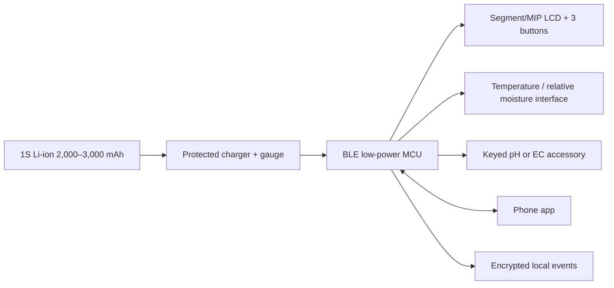

# AgriGrow Tier 0, Tier 1 and Tier 3 Portable Product SRS

**Document ID:** AGR-HW-022 | **Scope:** Tier 0 Soil Test Kit, Tier 1 Pocket Basic, Tier 3 FieldLab Backpack Kit. Tier 2 is specified in `02_hardware_device_srs.md`.

## 1. Product boundary

These products deliberately span different evidence grades. Tier 0 records a trained manual screening/protocol result; Tier 1 provides economical, quality-labelled spot measurements; Tier 3 is an FPO/KVK field-laboratory kit with reference controls and sample-chain discipline. No tier may display an unvalidated nutrient result as a laboratory assay.

| Product | User / job | Mandatory output | Prohibited claim |
|---|---|---|---|
| Tier 0 Soil Test Kit | First-time farmer with KVK/FPO/field-worker assistance | Sample ID, protocol, manual pH/EC/texture/colour result, lab referral | Direct N/P/K/organic-carbon/microbial “digital measurement” |
| Tier 1 Pocket Basic | Marginal/small farmer | Relative moisture, temperature and basic pH/EC screening with device/method quality | Lab-grade pH/EC or automatic fertiliser prescription |
| Tier 3 FieldLab Backpack | FPO, extension worker, progressive farmer | Repeated/referenced multi-point campaign, sample chain, field/lab linkage | Research-grade result without Tier 6 reference method/qualified operator |

## 2. Tier 0 Soil Test Kit

### Configuration and field protocol

Contents: stainless sampling auger, labelled sample bags, depth marker, clean mixing tray/spoon, disposable gloves, pH strip or comparator, EC/TDS pocket meter only where calibrated, texture/ribbon guide, distilled-water container, QR-labelled protocol card, waste pouch and replenishment log. Kit batch/lot/expiry is scanned before use.

`select field → scan kit and sample bag → collect 4 corners + centre at declared depth → exclude abnormal/shaded locations → mix → capture photo/notes → run labelled manual test → scan/enter comparator result → queue lab referral or screening advice`.

The protocol defaults to the Soil Health Card sampling approach: collected sample is coded, mixed and method-labelled. The digital record stores operator, kit lot, strip/comparator expiry, sample depth, medium, lighting/photo check and whether the result was human-read. A non-comparable/expired result is stored only as `invalid_screening`.

| Subassembly | Requirement | 10k-kit cost target, INR |
|---|---|---:|
| Sampling tools / tray / bags | 304/316 steel or food-safe polymer; serial/lot QR | 180–350 |
| pH colour kit / strips | Lot-controlled, stated range/expiry; comparator lighting instruction | 90–220 |
| Basic EC/TDS meter | Factory-checkable, replaceable battery; reference-solution check | 220–450 |
| Packaging / protocol / waste | Local-language pictograms and replenishment SKU | 80–160 |
| **Target COGS** | Excludes distribution/training/subsidy | **570–1,180** |

Acceptance: no expired consumable; 95% of trained operators complete traceable sample record; comparator repeatability study specifies lighting/observer error; lab correlation is presented as screening sensitivity/specificity, never an accuracy claim.

## 3. Tier 1 Pocket Basic

### Hardware architecture

The cost-down device has no PM, CO₂, camera, cellular or direct NPK function. It uses a rugged 2–3 button UI, BLE-to-phone, no mandatory GNSS chip (phone position is explicitly labelled), USB-C 5 V charging, replaceable probe lead and capped IP54 body. A single universal socket is not permitted: pH and EC accessories are mechanically keyed and identify type/lot via QR/EEPROM.

| Parameter | Method / limits | Release requirement |
|---|---|---|
| Relative soil moisture | Coated capacitive/FDR probe; no unqualified VWC claim | Show `wet / trend / dry` by soil profile; gravimetric correlation per pilot zone |
| Soil temperature | Probe NTC/RTD | ±0.8 °C system verification versus reference |
| pH screening | Replaceable electrode + 2-point check | Display only if calibration valid; target ±0.2 pH screening after check |
| EC screening | AC cell, stated cell constant | Display only if reference check passes; target ±5% reading screening |
| Ambient T/RH | Vented digital sensor | Shade/settling instruction; no weather-station claim |

| Cost element | Target INR | Cost-down condition |
|---|---:|---|
| MCU/BLE, memory, PCB/passives | 600–1,000 | Certified module/PCB revision shared with Tier 2 where possible |
| Display, buttons, buzzer, USB-C | 350–650 | No touchscreen or speaker |
| Battery, PMIC, enclosure | 650–1,000 | Serviceable battery door only after ingress validation |
| Probe set / ambient sensors | 900–1,700 | Sell probes/references separately where ownership model requires |
| Assembly, functional test, pack | 450–700 | Fixture verifies current, display, radio ID, probe inputs and charge |
| **Target COGS** | **2,950–5,050** | Retail band/ownership policy defined in business model |

Tier 1 validation: 1 m packed drop; USB/ESD; 0–50 °C functional exposure; 30-day offline queue; 100 BLE pairing/recovery cycles; 500 probe mate cycles; device/reference comparison; novice usability study; pH/EC calibration expiry lockout.

## 4. Tier 3 FieldLab Backpack Kit

### Configuration

| Module | Requirement |
|---|---|
| Rugged host | Tier 2 electronics plus 4–7 in daylight tablet/phone cradle, removable 10–20 Wh pack and cellular/Wi-Fi option. Host stores cryptographically signed campaign events. |
| Electrochemistry case | 3-point pH buffers, EC standards, rinse/distilled water, temperature probe, replaceable double-junction pH electrode, 4-electrode EC cell, spill tray and waste bottle. |
| Soil kit | Multi-depth FDR probes, auger/depth gauge, sample bags/barcodes, balance optional, moisture-reference sample labels. |
| Water kit | Water pH/EC/TDS, temperature, turbidity screening accessory; lab-chain barcode for contamination/heavy-metal analysis. |
| Evidence kit | QR sample labels, reference certificates, chain-of-custody form, photo board and offline map/campaign plan. |

Electrical interfaces are M12 or equivalent keyed low-voltage connectors for professional modules; RS-485/SDI-12 adapter is surge-protected and has an approved cable list. The backpack is IP54 closed and only opened on a clean work surface; wet-probe/waste storage is isolated from electronics and reference solutions.

### Campaign acceptance

Before capture, host validates operator role, field/crop, calibration certificate/expiry, probe serial, reference result, battery, storage and medium/depth. The campaign result is `validated` only if reference checks pass and sample chain is complete. Offline sync retains raw data, reference readings, corrective actions and original identity of a shared operator.

| Cost block | Target deployed INR | Notes |
|---|---:|---|
| Rugged host, battery and radio | 11,000–18,000 | Tablet/phone may be customer-owned to lower cost |
| Professional probes, standards, sample kit | 12,000–25,000 | Calibration/consumables are recurring operating cost |
| Case, connectors, adapters | 4,000–8,000 | Chemical-compatible dividers and spill containment |
| Assembly, validation, training | 3,000–7,000 | Includes initial reference-check fixture and operator training |
| **Target deployed COGS** | **30,000–58,000** | Excludes annual service and lab fees |

## 5. Portable service and launch gates

Launch requires an FPO/KVK pilot proving training completion, consumable replenishment, probe replacement, sample-chain accuracy, data-quality rate and repair turnaround. Tier 0/1 are distributed only with visible protocol and support path; Tier 3 requires an accountable organisation, trained operator and service contract. A cheap device without buffers, probe replacement and credible support is not an affordable product.
