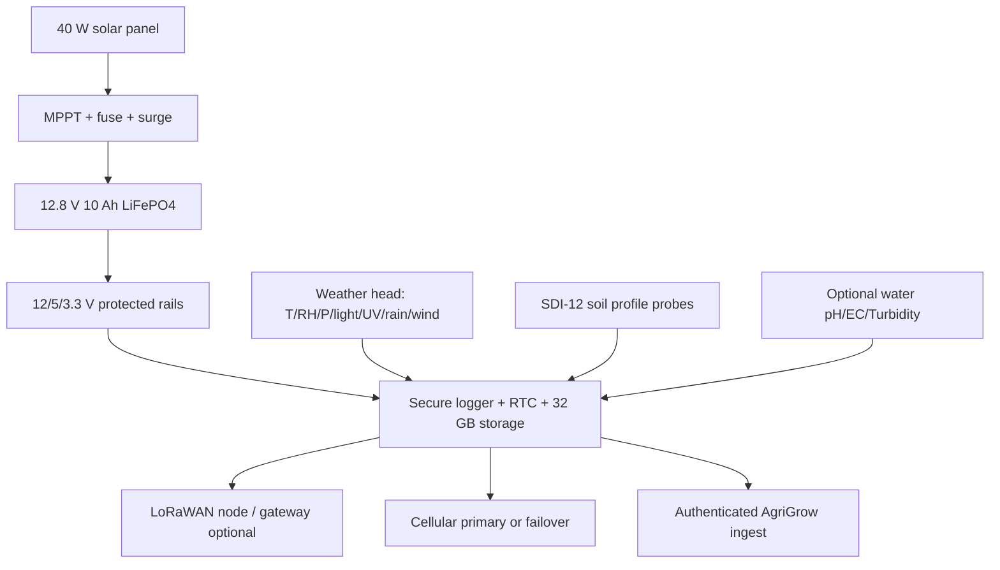

# AgriGrow Tier 4 Solar Farm Tower — System Requirements Specification

**Document ID:** AGR-HW-023 | **Purpose:** Fixed, continuous microclimate and soil/water observation; not an autonomous irrigation controller.

## 1. Reference architecture

## 2. Performance requirements

| Area | Requirement |
|---|---|
| Siting | 3 m mast minimum, secure foundation, known latitude/longitude, clear solar aspect, documented crop/irrigation context. Sensors follow manufacturer siting clearances; no station is accepted beside a wall, canopy obstruction, exhaust or reflective roof. |
| Enclosure | UV-stable IP65/66 electrical enclosure; breathable membrane; IP67 cable glands and M12 connectors; segregated high-voltage/low-voltage and lightning/surge zones. |
| Weather | Air T/RH, barometric pressure, solar/light, rain, wind speed/direction. Wind uses no-moving-parts ultrasonic or qualified cup/vane module; rain uses tipping bucket or validated optical/capacitive sensor and stores diagnostic state. |
| Soil | Minimum two depths selected by crop root zone; each probe has depth, orientation, installation method, soil profile, calibration and maintenance metadata. |
| Water | Optional isolated pH/EC/temp/turbidity module in protected flow cell or controlled sampling chamber; no permanent immersion unless probe supports it. |
| Sampling | Weather 1–5 min, soil 5–15 min, power/health 15 min; raw plus aggregate interval with time-sync confidence and gap reason. |
| Communications | Primary cellular or LoRaWAN gateway backhaul; local store-and-forward ≥90 days at 15-min aggregate; mutual TLS/certificate rotation. |
| Availability target | ≥95% valid-data availability per calendar month excluding documented maintenance and extreme-force-majeure periods. |

## 3. Energy design and calculation

Baseline daily load: weather/soil sensors and logger **10.8 Wh/day** (0.45 W average); cellular uploads/communications **7.2 Wh/day** (0.30 W average) = **18 Wh/day**. Worst-month usable solar energy for a 40 W panel at 3 peak-sun-hours and 65% system derating is `40 × 3 × 0.65 = 78 Wh/day`, giving >4× nominal daily energy margin. Three days of autonomy at 80% usable battery capacity requires `18 × 3 / 0.8 = 67.5 Wh`; the selected 12.8 V 10 Ah LiFePO₄ pack provides ~128 Wh nominal. This is a starting model: every deployment must use local irradiance, shadow, temperature, modem-duty and battery-age assumptions.

Electrical protections: panel fuse/disconnect, reverse-polarity protection, TVS/surge arrestors, earthing/bonding design, lightning-risk assessment, short-circuit current rating, battery BMS/thermal protection, brownout logging and service disconnect. No tower may connect a mains/AC pump circuit to the logger enclosure.

## 4. BOM and installation target

| Assembly | Target INR (10–50 station batch) | Acceptance |
|---|---:|---|
| Mast/foundation/brackets/cable management | 10,000–22,000 | Wind-load calculation/site photos/torque record |
| 40 W solar, LiFePO₄, MPPT, protection | 10,000–18,000 | Charge/discharge/current and surge checks |
| Secure logger, storage, cellular/LoRa, antenna | 12,000–24,000 | Provisioning, radio survey, offline recovery |
| Weather head, rainfall, wind | 14,000–35,000 | Reference check and siting clearance |
| Soil profile probes and install tooling | 12,000–45,000 | Depth/air-gap/soil-contact record |
| Enclosure/cables/connectors/assembly | 8,000–18,000 | Ingress, strain relief, labelling |
| Survey/install/commissioning | 12,000–30,000 | Signed site acceptance and health baseline |
| **Installed target** | **78,000–192,000** | Quote by site; excludes unusual civil works and annual O&M |

## 5. Installation and commissioning

1. Agronomist/installer selects management zone; performs radio and solar shade survey.
2. Create asset/site record: coordinates, ownership, crop, irrigation, photographs, depth/mast plan and consent/purpose.
3. Build foundation/mast, bond/earth where applicable, install solar/enclosure and verify safe voltage/current.
4. Install soil probes at declared depth using approved auger/tool; record soil contact and reference reading; install weather head to specified orientation/height.
5. Provision certificate, network credentials and radio test; run 24-hour burn-in and compare selected channels with reference tools.
6. Sign site acceptance only after time sync, sensor health, energy margin, queue/recovery and data-quality checks pass.

## 6. Maintenance and failure handling

Monthly remote review: solar yield, battery, link quality, time drift, sensor plausibility, enclosure humidity and missingness. Quarterly/seasonal visit: clean rain/light surfaces, inspect mast/glands/cables/earthing, verify pH/EC if fitted, inspect soil-probe cable/rodent damage and replace consumables. Annual visit: battery capacity assessment, sensor/reference comparison, firmware/security campaign and mounting torque/UV inspection.

On low battery, the station reduces sampling/upload duty in a documented sequence; it never changes irrigation. On sensor fault it emits `invalid` with reason and retains health telemetry. On communications loss it buffers; on storage pressure it preserves unsynced summaries and alerts service before ring-buffer deletion policy applies.

## 7. Qualification

Verify IP enclosure/cable system, UV/thermal/humidity, surge/ESD/lightning design, wind/mast load, solar/battery cold/hot charge, 30-day forced communications outage, brownout/restart, clock loss, sensor reference comparison, radio survey, cybersecurity/OTA rollback and installation repeatability. Seasonal field validation across at least three agro-climatic zones is required before availability or advisory benefit claims.
